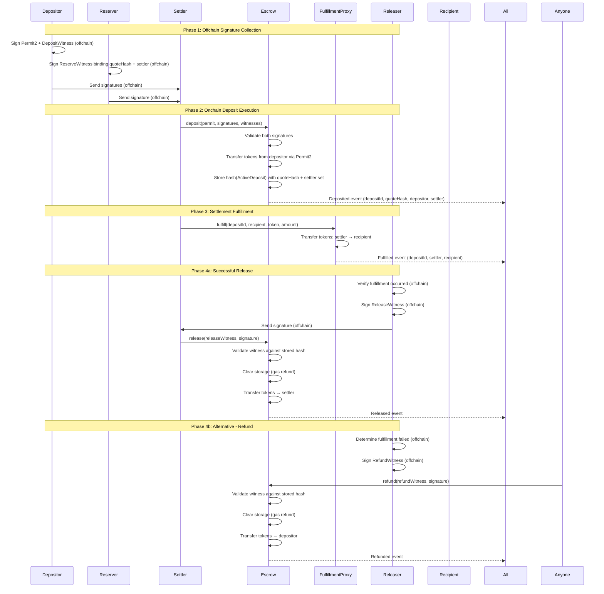
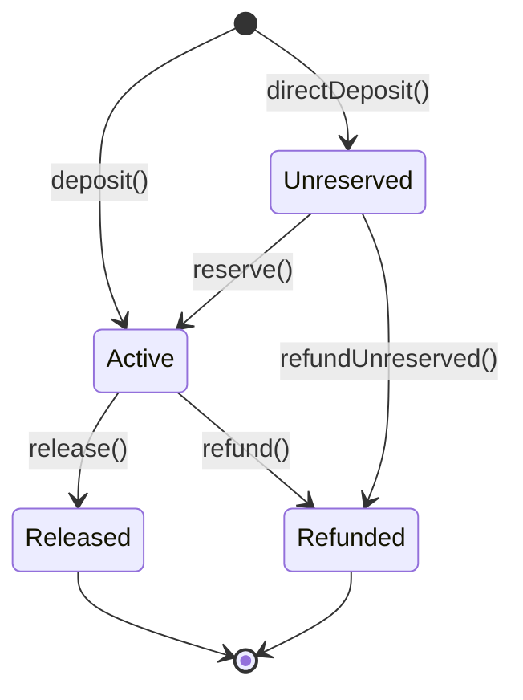

# Atum On-Chain Settlement Protocol - Technical Specification

## Overview

The Atum protocol implements an **intent-based payment system** using a dual-contract architecture for secure, condition-based token transfers. This specification describes the current implementation of the pilot version.

## Architecture

### Contract Components

**Escrow Contract (Source/Any Chain)**
- Holds deposited funds with multi-party authorization
- Permit2 path: atomic deposit + reserve (both signatures needed upfront); direct path: the owner
  account deposits first and the reserver signs at `reserve()`
- Releases funds to designated settler after verification
- Provides refund mechanism for failed settlements
- Uses hash-based storage optimization for gas efficiency

**FulfillmentProxy Contract (Destination/Any Chain)**  
- Executes token transfers from settlers to recipients
- Provides on-chain audit trail linking to escrow deposits via `depositId`
- Supports batch operations for efficiency
- Optional deadline enforcement for time-sensitive payments

### Key Participants

| Actor | Role | Responsibilities |
|-------|------|------------------|
| **Depositor** | Payment initiator | Signs Permit2 authorization to deposit tokens into escrow, or (direct path) approves the escrow and calls `directDeposit` itself |
| **Reserver** | Settler selector | Co-signs deposit to designate specific settler (cannot be changed later) |
| **Releaser** | Settlement verifier | Authorizes release to settler OR refund to depositor |
| **Settler** | Liquidity provider | Receives escrowed funds upon successful fulfillment |
| **Recipient** | Payment receiver | Final destination of tokens in fulfillment transaction |

## Current Implementation Flow



## State Model

### Escrow Deposit States



| State | Description | Storage |
|-------|-------------|---------|
| **Unreserved** | Direct deposit before `reserve()`: refundable by its depositor alone (`refundUnreserved()`), not releasable (`NotReserved`) nor refundable by the releaser (`QuoteHashCannotBeEmpty`) | `keccak256(ActiveDeposit)` stored with zero `quoteHash`, `settler` and `feeAmount` |
| **Active** | Deposit exists with settler designated | `keccak256(ActiveDeposit)` stored |
| **Released** | Funds sent to settler (final state) | Storage cleared (bytes32(0)) |
| **Refunded** | Funds returned to depositor (final state) | Storage cleared (bytes32(0)) |


## Contract Interfaces

### Escrow Contract

#### Constructor

**`constructor(IPermit2 permit2, address defaultAdmin)`**
- Deploys new Escrow contract instance
- Sets immutable Permit2 reference (`i_permit2`)
- Sets initial default admin (uses AccessControlDefaultAdminRules with 1-second delay)
- Initializes EIP-712 domain with name "Escrow" and version "3"
- Admin can grant roles: `PAUSER_ROLE`, `TREASURER_ROLE`, `TOKEN_CONFIG_ROLE`
- Tokens are added after deployment via `allowToken()` or `allowTokenAndSetFeeConfig()`

#### Core Functions

**`deposit(DepositInput calldata depositInput) returns (bytes32 depositId)`**
- Requires both depositor signature (via Permit2) AND reserver signature
- Creates escrow with settler already designated
- Validates token is allowlisted
- Rejects a zero `depositWitness.depositRequestHash` (`DepositRequestHashCannotBeEmpty`)
- Rejects an empty `depositWitness.destination` (`DestinationCannotBeEmpty`) or one longer than
  256 bytes (`DestinationTooLong(length)`); only `keccak256(bytes(destination))` is stored
- Returns unique `depositId` = `keccak256(depositor, signature, nonce)`
- Stores `keccak256(ActiveDeposit)` for gas optimization
- Emits `Deposited` and, in the same transaction, `DepositCommitments` (the two commitment hashes,
  which `Deposited` deliberately does not carry) — `depositMany()` emits neither, see
  [`DepositCommitments` and log-only witness recovery](#depositcommitments-and-log-only-witness-recovery)

**`directDeposit(DirectDepositInput calldata input) returns (bytes32 depositId)`**
- For accounts that cannot sign a Permit2 message (Tempo access keys, CORE-3048). The caller is the
  depositor: the owner account executes the deposit itself. DEPOSIT-FIRST: the deposit is stored
  UNRESERVED, with a zero `quoteHash`, `settler` and `feeAmount`, and `reserve()` sets them later
  with the reserver's signature. Permit2 `deposit()` stays atomic and is untouched
- `amount` is the payer's `max_source_amount`, fees included. The payer deposits all of it because
  the quotes have not been solicited yet; `reserve()` charges the winning quote's source amount and
  sends the rest back
- Funded by the owner's `approve(escrow, amount)` in the same batch (one Tempo transaction carries
  both calls): `directDeposit` pulls `amount` with `transferFrom(msg.sender, escrow, amount)` after
  every state write, and measures the escrow's balance across the pull like `deposit()` does, so a
  short or inflated delivery reverts `NonExactTransfer(expected, received)`. A missing or short
  approval reverts in the token. The pull is bound to the caller, so the deposit is bound to its
  own funding on any chain; the batch is a convenience, not a safety requirement
- **Spending limits (Tempo).** Tempo charges an access key's spending limit on the key's own
  top-level `approve` (the increase), not on the escrow's `transferFrom`. A key scoped to
  `directDeposit` can therefore spend any allowance the ROOT account left to the escrow without
  touching its own limit. The approval in the batch is what the limit meters, so the root account
  must never approve the escrow directly (its Permit2 approval goes to the Permit2 contract and is
  unaffected). This is an operational rule for the originator; the contract cannot tell whose
  approval an allowance came from
- No depositor signature. What the Permit2 path binds through the depositor's signature (token,
  amount, nonce, witness) is bound into the deposit id instead, see
  [depositId Calculation](#depositid-calculation)
- Replay guard: a per-owner unordered nonce bitmap (word = `nonce >> 8`, bit = `nonce & 0xff`), the
  shape of Permit2's `nonceBitmap`; a spent nonce reverts `NonceAlreadyUsed(nonce)` and is never
  cleared, so a released or refunded direct deposit cannot be re-funded under the same id
- No expiry and no fee cap on the source chain. The fulfillment deadline is enforced off chain by
  veri-fill against the destination chain's clock when it authorizes a release or a refund, and
  the fee is computed at `reserve()` on the charged amount, the point at which the Permit2 path
  computes it
- Check order: `whenNotPaused`, token allowlist, reserver/releaser non-zero, non-zero
  `depositRequestHash`, `destination` 1..256 bytes, `amount > 0` (`DepositAmountCannotBeZero`),
  nonce, no still-active deposit under the derived id (`DepositAlreadyExists`), then the pull
- Stores `keccak256(ActiveDeposit)` with `depositor = msg.sender` and `quoteHash`, `settler` and
  `feeAmount` zero. Until `reserve()` has run, `release()` reverts `NotReserved` and the releaser's
  `refund()` reverts `QuoteHashCannotBeEmpty`; only the depositor can take it back, with
  `refundUnreserved()`, which returns the full `amount`. Without the depositor, the reserver and
  the releaser together can still return it: a `reserve()` at the full amount (no overpayment, and
  a `DepositReserved` naming the chosen quote and settler), then the releaser's `refund()`. This
  fails only for a token disallowed since the deposit (`TokenNotAllowed`) or an amount the fee
  floor exceeds (`FeeExceedsDepositAmount`)
- Snapshots all fee terms (percentage, minimum, maximum and token decimals) at funding, before
  calling the token. `getDirectDepositFeeConfig(depositId)` exposes them while unreserved. Token
  config changes, including clearing fees or disallowing and reallowing the token, cannot rewrite
  these terms. Reservation uses the snapshot on the winning `sourceAmount`, not on the maximum.
  Successful reservation or unreserved refund clears the snapshot before outbound transfers;
  failed transfers roll that deletion back. Unknown or no-longer-unreserved ids return zero fields.
- Emits `Deposited` (zero `quoteHash`, `settler` and `feeAmount`) and `DepositCommitments` exactly as
  `deposit()` does. **The logs do not distinguish the two paths** beyond the zero settler; a consumer
  that needs to know must inspect the call's own input (one of the batch's calls on Tempo), or a
  trace when the caller is a contract

**`reserve(ReserveInput calldata input)`**
- Sets settler and quote on an unreserved direct deposit and charges the winning quote, with the
  reserver's EIP-712 signature over the same `ReserveWitness` the Permit2 path uses. Anyone may submit it (the settler does, it is the
  `executor.reserve` of the request); the signature is the gate
- The stored hash is opaque, so the input carries the unreserved tuple members (`depositor`,
  `token`, `amount`, the `DepositWitness`). The contract looks up `reserveWitness.depositId`
  (`DepositNotFound` if nothing is stored), rebuilds the unreserved tuple and requires its hash to
  equal the stored one (`InvalidWitnessValues`; an already-reserved deposit fails here too,
  indistinguishable from a wrong tuple). That match is the whole binding: only `directDeposit`
  stores a tuple with a zero `quoteHash` (`deposit()` rejects one), and it stores it under the id it
  derived from these same members, so the id is not re-derived
- No deadline: a valid reserver signature can be submitted until the deposit is reserved or
  refunded. Source-chain ordering settles the race with the depositor's `refundUnreserved()`:
  whichever lands first clears or rewrites the slot, and the other reverts (`DepositNotFound` for a
  reserve after the refund, `InvalidWitnessValues` for a refund after the reserve). A settler must
  therefore not authorize or fulfil before `getDepositHash(id)` holds the reserved tuple naming it (or its `DepositReserved` log is final): anyone may submit the same signature first, and the settler's own `reserve()` then reverts `InvalidWitnessValues` although the deposit is reserved for it
- Reverts `SettlerCannotBeZeroAddress`, `QuoteHashCannotBeEmpty`, `InvalidSourceAmount` unless
  `0 < reserveWitness.sourceAmount <= amount`, `TokenNotAllowed` if the token was disallowed since
  the deposit (a live allowlist check, independent of the fee snapshot), `FeeExceedsDepositAmount` when the fee on the charged
  amount is at or above it, `InvalidSignature` on a bad reserver signature; `whenNotPaused`
- Charges the quote: the stored tuple gets `amount = sourceAmount`, `feeAmount =
  determineFee(sourceAmount, depositTimeTokenConfig)` at reserve time, and the `quoteHash` and `settler`. Emits
  `DepositReserved(depositId, quoteHash, settler, amount, feeAmount)` with the charged amount and its
  fee. Then, LAST, sends the overpayment `amount - sourceAmount` back to the depositor, if any.
  Release then works as for a Permit2 deposit, on the charged amount
- A depositor the token refuses to pay (a frozen account) blocks every path that pays the depositor:
  a `reserve()` below the maximum, `refundUnreserved()` and `refund()` all revert until the account
  is unfrozen, as `refund()` does for a frozen Permit2 depositor. A `reserve()` at
  `sourceAmount == amount` sends nothing and then release works, but it charges the full maximum. A
  token disallowed since the deposit is different: `reserve()` reverts `TokenNotAllowed` and
  `refundUnreserved()` still works
- Implementation note: the body is `EscrowReserveLib.reserve` (`src/EscrowReserveLib.sol`), an
  external library the escrow delegatecalls with its raw calldata, purely for EIP-170; see
  [Contract size and the reserve library](#contract-size-and-the-reserve-library). Storage, the
  emitted event and `address(this)` are the escrow's

**`depositMany(DepositInput[] calldata depositInputs) returns (bytes32[] memory depositIds)`**
- Batch version of `deposit()` for gas efficiency
- Processes multiple deposits in single transaction
- Each deposit requires its own depositor and reserver signatures
- Returns array of generated `depositId`s
- Validates each token is allowlisted
- Emits single `DepositedMany` event with all deposits

**`release(ReleaseInput calldata releaseInput)`**
- Requires releaser signature via EIP-712
- Validates witness data against stored hash
- Transfers tokens to settler
- Clears storage (prevents replay)
- Emits `Released` event

**`releaseMany(ReleaseInput[] calldata releaseInputs)`**
- Batch version of `release()` for gas efficiency
- Processes multiple releases in single transaction
- Each release requires its own releaser signature
- All witness data validated against stored hashes
- Clears storage for each deposit
- Emits single `ReleasedMany` event with all releases

**`refund(RefundInput calldata refundInput)`**
- Requires releaser signature via EIP-712
- Requires a non-zero `quoteHash` (`QuoteHashCannotBeEmpty`), so it refunds reserved deposits
  only; an unreserved direct deposit is refunded by its depositor with `refundUnreserved()`
- Validates witness data against stored hash
- Returns tokens to original depositor
- Clears storage (prevents replay)
- Emits `Refunded` event

**`refundMany(RefundInput[] calldata refundInputs)`**
- Batch version of `refund()` for gas efficiency
- Processes multiple refunds in single transaction
- Each refund requires its own releaser signature
- All witness data validated against stored hashes
- Clears storage for each deposit
- Emits single `RefundedMany` event with all refunds

**`refundUnreserved(RefundUnreservedInput calldata input)`**
- Refunds an unreserved direct deposit to its depositor, called by the depositor alone, with no
  signature. Not permissionless: the caller must be the account that called `directDeposit()` (the
  Tempo root account when an access key signed the batch), which is also the owner's recovery if
  that key is revoked
- Rebuilds the unreserved tuple with `depositor = msg.sender` and zero `quoteHash`, `settler` and
  `feeAmount`, and requires its hash to equal the one stored under `depositId` (`DepositNotFound`
  if nothing is stored, `InvalidWitnessValues` otherwise). Another caller, a reserved deposit and
  a Permit2 deposit all fail this match by construction, with no separate check
- Clears storage, transfers the full deposited `amount` to the depositor, and emits `Refunded`
  exactly as `refund()` does
- No new storage: "unreserved" is the stored tuple's zero `quoteHash` and `settler`. The race with
  `reserve()` is settled by source-chain ordering (see `reserve()` above)
- `whenNotPaused`, like every transition: a pause, which can come from outside conditions such as
  a compromised or sanctioned token, blocks the depositor's refund too

#### Administrative Functions

**`allowToken(IERC20 token, uint8 decimals)`** (TOKEN_CONFIG_ROLE only)
- Adds token to allowlist with specified decimals (without fees initially)
- Required before token can be deposited
- Emits `TokenAllowed` event

**`allowTokenAndSetFeeConfig(IERC20 token, uint8 decimals, uint88 feePercentage, uint80 minFee, uint80 maxFee)`** (TOKEN_CONFIG_ROLE only)
- Adds token to allowlist with decimals and fee configuration in one call
- Combines `allowToken` and `setTokenFeeConfig`

**`setTokenFeeConfig(IERC20 token, uint88 feePercentage, uint80 minFee, uint80 maxFee)`** (TOKEN_CONFIG_ROLE only)
- Updates fee configuration for an already-allowlisted token
- Fee values are scaled by 10^6 (e.g., 20,000 = 0.02%, 250,000,000 = $250)
- Emits `TokenFeesUpdated` event

**`clearTokenFeeConfig(IERC20 token)`** (TOKEN_CONFIG_ROLE only)
- Clears all fee parameters for a token (sets to zero)
- Token remains allowlisted
- Emits `TokenFeesCleared` event

**`disallowToken(IERC20 token)`** (TOKEN_CONFIG_ROLE only)
- Removes token from allowlist
- Existing deposits can still be released/refunded
- Emits `TokenDisallowed` event

**`withdrawFeeRevenue(IERC20 token, address recipient)`** (TREASURER_ROLE only)
- Withdraws accumulated protocol fees for a token
- Transfers fees to specified recipient
- Emits `FeeRevenueWithdrawn` event

**`pause()`** (PAUSER_ROLE only)
- Pauses all core operations (deposit, release, refund, fulfill)
- Emergency stop mechanism for security incidents
- Emits `Paused` event

**`unpause()`** (PAUSER_ROLE only)
- Resumes all core operations
- Only callable when contract is paused
- Emits `Unpaused` event

**`beginDefaultAdminTransfer(address newAdmin)`** (DEFAULT_ADMIN_ROLE only)
- Initiates two-step admin transfer with delay
- From AccessControlDefaultAdminRules for safe admin transfer

**`acceptDefaultAdminTransfer()`** (Pending Admin only)
- Completes admin transfer after delay period
- Callable only by pending admin

#### View Functions

**`getDepositHash(bytes32 depositId) returns (bytes32)`**
- Returns stored hash for active deposits
- Returns `bytes32(0)` for completed/non-existent deposits
- Use to check if deposit is active: `hash != bytes32(0)`
- Compute expected hash: `keccak256(abi.encode(ActiveDeposit))`

**`isTokenAllowed(IERC20 token) returns (bool isAllowed)`**
- Check if token is allowlisted and can be deposited
- Returns `true` if token is in allowlist, `false` otherwise

**`getTokenConfig(IERC20 token) returns (TokenConfig memory)`**
- Returns the full token configuration (decimals and fee parameters)
- Returns zero values if token is not allowlisted
- TokenConfig includes: `feePercentage6Decimals`, `maxFee6Decimals`, `minFee6Decimals`, `tokenDecimals`

**`getAllowedTokens() returns (IERC20[] memory allowedTokens)`**
- Returns array of all allowlisted token addresses
- Useful for frontend/integration to show supported tokens

**`determineFee(uint256 amount, TokenConfig memory tokenConfig) returns (uint256 feeAmount)`**
- Calculates the protocol fee for a given amount and token configuration
- Useful for off-chain fee estimation

**`i_permit2() returns (IPermit2)`**
- Immutable reference to the Permit2 contract
- Set during construction, cannot be changed
- Used for all deposit token transfers

**`hasRole(bytes32 role, address account) returns (bool)`**
- Check if account has a specific role
- Standard AccessControl function

**`getRoleAdmin(bytes32 role) returns (bytes32)`**
- Returns the admin role for a given role
- Standard AccessControl function

**`defaultAdmin() returns (address)`**
- Current default admin (from AccessControlDefaultAdminRules)
- Admin can grant/revoke roles

**`pendingDefaultAdmin() returns (address newAdmin, uint48 schedule)`**
- Returns pending admin and when the transfer can be accepted
- Returns zero values if no admin transfer is pending

**`paused() returns (bool)`**
- Returns `true` if contract is paused, `false` otherwise
- When paused, all core functions revert

### FulfillmentProxy Functions

> **Note**: FulfillmentProxy is deployed as a separate contract from Escrow. Each contract has its own admin and pause control.

#### Core Functions

**`fulfill(Fulfillment calldata params)`**
- Transfers tokens from `msg.sender` (settler) to recipient
- `msg.sender` is recorded as the settler in event
- No deadline check - use for gas-efficient fulfillment
- Emits `Fulfilled` event with `depositId`, settler, and timestamp
- Uses standard ERC20 `transferFrom` (requires prior approval)

**`strictFulfill(Fulfillment calldata params, uint256 deadline)`**
- Same as `fulfill()` but with deadline enforcement
- Reverts if `block.timestamp > deadline`
- Provides safety check against transaction delays
- Emits `Fulfilled` event on success
- Slightly higher gas cost due to deadline check

**`fulfillMany(Fulfillment[] calldata params)`**
- Batch version of `fulfill()` for gas efficiency
- Processes multiple fulfillments in single transaction
- All transfers execute from same `msg.sender` (settler)
- No deadline checks - optimized for gas
- Emits single `FulfilledMany` event with all fulfillments
- Reverts entire batch if any transfer fails

> **Note**: FulfillmentProxy has its own administrative functions (pause, unpause, role management) separate from Escrow. It carries a `PAUSER_ROLE` for pause control and a `SETTLER_ROLE` that gates `strictFulfill` when the settler allowlist is enforced (CORE-2116).
>
> **`SETTLER_ROLE` ships dormant and must be enabled at cutover.** `strictFulfill` keys its idempotency marker on the bare `quoteHash`, and that value is published as an indexed topic in `Escrow.Deposited` on the source chain before the destination fulfillment. While `s_settlerAllowlistEnforced` is `false` — the deployed default — any caller can therefore consume a known `quoteHash` for the price of gas and permanently block the legitimate settler on the strict path: the marker has no setter, no admin reset and no upgrade path, so granting the role afterwards does not undo it. The non-strict `fulfill` path is unaffected, so this is a liveness failure rather than a loss of funds. Grant `SETTLER_ROLE` and call `setSettlerAllowlistEnforced(true)` in one admin batch before routing payments to a new deployment.

## Data Structures

### Escrow Structures

#### deposit() Function

```solidity
struct DepositInput {
    ISignatureTransfer.PermitTransferFrom permit;  // Permit2 authorization
    address depositor;                              // Token owner
    DepositWitness depositWitness;                  // Contains depositRequestHash, destination, reserver, releaser
    bytes depositSignature;                         // Depositor's EIP-712 signature
    ReserveWitness reserveWitness;                  // Contains depositId + quoteHash + settler + sourceAmount
    bytes reserveSignature;                         // Reserver's EIP-712 signature
}

struct DepositWitness {
    bytes32 depositRequestHash; // Depositor's commitment to the offchain deposit request (non-zero;
                                //   derivation defined off-chain, see below)
    string destination;         // Plaintext destination, 1..256 bytes; ratified grammar
                                //   <caip19-asset>@<account>, not enforced on-chain (see below)
    address reserver;           // Authorized to set settler
    address releaser;           // Authorized to release/refund
}

struct ReserveWitness {
    bytes32 depositId;         // Unique deposit identifier (cryptographically commits to all deposit details)
    bytes32 quoteHash;        // Offchain quote hash
    address settler;           // Designated fund recipient
    uint256 sourceAmount;      // Winning quote's source amount — the actual charge (<= permit cap; <= amount on reserve())
}

// Permit2 structure (from Uniswap Permit2)
struct PermitTransferFrom {
    TokenPermissions permitted;  // Token and amount
    uint256 nonce;              // Unique nonce
    uint256 deadline;           // Signature expiry
}

struct TokenPermissions {
    address token;     // Token to transfer
    uint256 amount;    // Authorization CEILING, not the amount transferred (see note)
}
```

> **`permit.permitted.amount` is a ceiling, not a charge.** The escrow pulls
> `reserveWitness.sourceAmount` — the reserver-attested winning quote — and requires
> `0 < sourceAmount <= permit.permitted.amount` (`InvalidSourceAmount`). The depositor signs the
> ceiling; the reserver picks the charge underneath it. `Deposited.amount`, `ActiveDeposit.amount` and
> the `amount` member of both settlement witnesses are all `sourceAmount`, never the ceiling. A signer
> that sets the two equal is authorizing exactly the quoted amount, which is legitimate but leaves no
> room for a smaller winning quote.
>
> **The PROTOCOL FEE is charged on `sourceAmount` too, which makes `FeeExceedsDepositAmount` newly
> reachable from `deposit()`.** `determineFee` is applied to the winning quote, not to the ceiling, so
> a deposit whose `sourceAmount` is at or below the token's configured **minimum fee** now reverts
> `FeeExceedsDepositAmount(sourceAmount, feeAmount)` — the whole deposit fails, at deposit time. The
> same quote under a large permit ceiling used to be charged a percentage of the ceiling and go
> through. Integrators must therefore **size quotes strictly above the configured `minFee`** for the
> source token; read it from `getTokenConfig(token).minFee6Decimals` (expressed in 10^6 units, scaled
> by `10^tokenDecimals / 10^6`) rather than assuming a floor. `depositMany()` applies the same check
> per item with no per-item tolerance, so one dust-sized winner reverts the entire batch. Pinned end to
> end, through the real `deposit()`/`depositMany()` path, by `test/Escrow.feeFloor.t.sol`.

#### directDeposit() and reserve() Functions

```solidity
struct DirectDepositInput {
    address token;                  // Source token, must be allowlisted
    uint256 amount;                 // max_source_amount, fees included; pulled in full
    uint256 nonce;                  // Per-owner unordered nonce, spent on success
    DepositWitness depositWitness;  // Same struct as the Permit2 path
}

struct ReserveInput {
    address depositor;              // The owner account that made the deposit
    address token;                  // The deposit's token
    uint256 amount;                 // The deposit's amount, as deposited
    DepositWitness depositWitness;  // The deposit's witness
    ReserveWitness reserveWitness;  // Same struct as the Permit2 path; 0 < sourceAmount <= amount
    bytes reserveSignature;         // Reserver's EIP-712 signature over reserveWitness
}
```

`DirectDepositInput` has no `depositor` member (it is `msg.sender`) and no reserve member (the
deposit is stored unreserved). `ReserveInput` carries everything `reserve()` needs to rebuild the
stored tuple; every member is in the deposit's `Deposited` and `DepositCommitments` logs except the
destination plaintext, which the request carries. The three structs (with `RefundUnreservedInput`,
see [refund() Function](#refund-function)), `DepositReserved`, the error `NonceAlreadyUsed`,
`directDeposit` and `reserve` live in `IEscrow` next to the Permit2 path's; the witnesses, events
and every other error are shared unchanged.

#### `destination` and `depositRequestHash`: what the contract defines, and what it does not

Both are depositor-signed commitments that the escrow stores and then requires the settlement witness
to reproduce exactly. **Neither has its content defined by this contract.** Read this before writing a
producer or a consumer of either value.

**What the contract enforces about `destination`** is only: non-empty (`DestinationCannotBeEmpty`), at
most 256 bytes (`DestinationTooLong(length)`), and that `keccak256(bytes(destination))` matches at
settlement. It never parses the string. The grammar below is a **protocol-level agreement between
producers and consumers, not on-chain validation**: the contract is format-agnostic and accepts any
1..256-byte string, including one that violates the grammar outright.

**`destination` — the grammar is RATIFIED.** A `destination` is a CAIP-19 asset identifier, a literal
`@` separator, and then the destination account address in its namespace's native form:

```
<caip19-asset-id>@<account-address>
<caip2-chain-id>/<asset-namespace>:<asset-reference>@<account-address>

eip155:8453/erc20:0x833589fcd6edb6e08f4c7c32d4f71b54bda02913@0xc0ffee254729296a45a3885639ac7e10f9d54979
```

This is the shape already used throughout this repository, and it is the ratified grammar: which chain
and which asset (CAIP-19), then `@`, then the account that is to receive that asset, spelled the way
its own namespace spells addresses (hex for `eip155`, base58 for `solana`, and so on). The example is
spelled in canonical form under the ratified per-segment casing rule below. Note that it is
neither CAIP-10 (`chain_id:account_address`, which has no asset part and no `@`) nor plain CAIP-19
(which identifies an asset and has no account part) — it is a local composition of the two. Earlier
revisions of this document and of the source comments described it as "CAIP-10-style" and as "a
CAIP-19 asset plus a base58 account"; both were wrong, and a policy engine written to either
description fails to parse every destination the corpus actually contains. Also note that the only
plaintext `destination` values in `encoding-examples.json` — the two `deposit` entries — use
abbreviated placeholders (`0xaaaa`, `0xbbbb`): that file is a signing-digest fixture, **not** a format
reference.

**Byte-exactness is a requirement, not a caveat.** The producer that signs the deposit and every
consumer that rebuilds a `ReleaseWitness`/`RefundWitness` MUST emit **byte-identical** strings for the
same destination. The contract stores and compares `keccak256(bytes(destination))`; it validates only
the 1..256-byte length and therefore **cannot detect a format disagreement** — a destination that is
malformed, or merely spelled differently, hashes to something that simply will not match later. If the
depositor and the releaser disagree by a single byte, the settlement witness cannot reproduce the
stored `ActiveDeposit` hash and the deposit is **neither releasable nor refundable**; this escrow has
no rescue function. Conformance has to be enforced upstream — in the normative protocol-level schema
and in the producers — because nothing on-chain will enforce it.

**CASING — RATIFIED (per segment).** The rule is: **lowercase everything, except base58 values, which
are case-significant and MUST be preserved byte-for-byte.** Enforcement is **off-chain**, in producers
and consumers; the contract stays format-agnostic and validates nothing beyond the 1..256-byte length.
Normatively, per segment:

| Segment | Example | Rule |
| --- | --- | --- |
| Chain namespace | `eip155`, `solana` | lowercase (CAIP-2 already requires this) |
| `eip155` chain reference | `8453` | decimal digits — no case |
| Asset namespace | `erc20`, `token`, `slip44` | lowercase (CAIP-19 already requires this). On `solana` the ratified spelling is **`token`**, not `spl` — see the note below |
| Hex values — `eip155` asset references AND account addresses | `0x833589fc…2913` | **lowercase. Explicitly NOT EIP-55**: the checksummed rendering is a different byte string and a different commitment |
| Base58 values — everywhere they occur | `EPjFWdd5…Dt1v` | **preserve exact case.** Base58 is case-significant: re-casing yields a different value, not a different spelling |

**On `solana`, `token` is ratified and `spl` is what two SDKs actually emit.** The table above,
the keccak-pinned canonical example below, the destination conformance vectors and the EVM/TVM/SVM
canonical-example tests all spell it `token`. Nothing in the SDK layer emits `token` from code:
`x402-atum-escrow/src/chain-adapters/solana.ts` and `mppx-atum-escrow/src/internal.ts` both emit
`spl`, matching the live settler chain-plugin configs.

Nothing enforces either spelling. The composer validates the asset namespace for shape and
lowercase-ness only — there is deliberately NO allow-list, because one would reject the ratified
`slip44` example pinned below, the `erc721` case the SDK tests assert, and the frozen ed25519
signing fixtures. So `spl:` and `token:` BOTH compose into well-formed, DIFFERENT commitments.

What keeps that from stranding deposits is not the spellings agreeing. **The destination is derived
exactly once per payment and transported verbatim.** The producer writes one value into both the
signed witness and `payment_request.destination[0]`; the release and refund signers read that field
back off the stored request rather than re-deriving it (atum-core `libs/escrow-commitments`,
reached through `SelectCommittedDestination` then `BuildDestination` in both wallet-orch and
solver-gw). Both signers therefore hash the same bytes whichever spelling the producer chose.

Two consequences worth stating, because a reader who assumes the spellings are the invariant will
reach the wrong conclusion in both directions. A producer that RE-DERIVES the identifier instead of
reusing it can strand a deposit even with no spelling change at all. And converging the SDKs on
`token` is safe for the commitment, but must not be done without first checking settler-side
corridor subscriptions: solver-gw's own registry lookup discards the asset namespace, so nothing in
atum-core depends on it, but the settler plugins are a separate repo.

The base58 carve-out is per-**segment**, not per-namespace, and on `solana` it covers **THREE segments,
not one**: the CAIP-2 chain reference (the truncated genesis hash), the SPL mint in the asset
reference, AND the account address are all base58. A blanket "lowercase the whole string" applied to a
Solana destination corrupts all three at once — this is the easiest way to get the rule wrong.

**Why the rule exists** — worked example (derived with `cast keccak`): one real corpus destination,
account mixed-case and then in canonical all-lowercase form.

```
eip155:8453/erc20:0x833589fcd6edb6e08f4c7c32d4f71b54bda02913@0xc0ffee254729296a45a3885639AC7E10F9d54979
  -> 0x20de32487c3d0b0b0f90543749846aca433bd31fe14beee53d48d64f7eba8e3b
eip155:8453/erc20:0x833589fcd6edb6e08f4c7c32d4f71b54bda02913@0xc0ffee254729296a45a3885639ac7e10f9d54979
  -> 0x7e096a6d1abcfc4daab28cec3f3d3a458c3facbfa0f3493284bb891bdc9807ef
```

Same destination under the ratified grammar, one field re-cased, two irreconcilable commitments — and
casing is exactly the byte-exactness hazard the previous section warns about. The divergence is not
hypothetical: re-casing the *asset* address of that same destination gives
`0x7a271366eebefa42e0e31ceba3fcb469d02f6781104a66f208b8977032b38d51` (asset EIP-55) against
`0x20de32487c3d0b0b0f90543749846aca433bd31fe14beee53d48d64f7eba8e3b` (asset lowercase), and **both of
those hashes are live in this repository** — the first as the `release[1]`/`refund[1]`
`destinationHash` in `encoding-examples.json`, the second as `DESTINATION_HASH` in
`test/Escrow.canonicalDigest.t.sol`. Those fixtures predate this rule and feed pinned digest literals,
so they are deliberately kept as-is (and labelled non-canonical in place); they are byte strings under
test, not format guidance.

**Canonical example set.** These follow the ratified grammar AND the ratified casing rule; copy from
these, not from test fixtures. They are pinned, with their keccak256 hashes, in
`test/Destination.canonicalExamples.t.sol`, whose conformance tests mechanically re-check them against
the casing rule.

```
eip155:8453/erc20:0x833589fcd6edb6e08f4c7c32d4f71b54bda02913@0xc0ffee254729296a45a3885639ac7e10f9d54979
  -> 0x7e096a6d1abcfc4daab28cec3f3d3a458c3facbfa0f3493284bb891bdc9807ef   (103 bytes)
eip155:1/slip44:60@0xc0ffee254729296a45a3885639ac7e10f9d54979
  -> 0x7f145a7e736ea3b627f216bc20d0fee3dccd897fd88bed8a703527b025d18a75   (61 bytes)
solana:5eykt4UsFv8P8NJdTREpY1vzqKqZKvdp/token:EPjFWdd5AufqSSqeM2qN1xzybapC8G4wEGGkZwyTDt1v@9WzDXwBbmkg8ZTbNMqUxvQRAyrZzDsGYdLVL9zYtAWWM
  -> 0x6e6a064bee8339ac86f3894ef404261671f23c0df96b83495db4e46f53ffca11   (135 bytes)
```

The first is Base USDC to an EOA, hex all-lowercase throughout. The second is native ETH (`slip44:60`)
on mainnet — the asset reference is decimal, so the only cased segment is the lowercase hex account.
The third is Solana-mainnet USDC (CAIP-2 reference `5eykt4Us…`, SPL mint `EPjFWdd5…`) to a base58
account — all three base58 segments keep their exact mixed case, and lowercasing that string changes
its hash to `0xf5c5c7c6f9ec77f1d16171c50c82be44ecc01848ff82dd62c88b45d4064d673d`, i.e. a different,
unsettleable commitment. The rule must also be recorded in the normative protocol-level schema that
producers and consumers implement against; this document and the conformance test pin the contract-side
statement of it.

**`depositRequestHash` — derivation defined off-chain.** The contract requires only that it is
non-zero on the deposit path (`DepositRequestHashCannotBeEmpty`) and that the settlement witness
reproduces it. What it is a hash *of* — which deposit-request fields, in what encoding, under what
domain — is defined by the off-chain protocol layer that issues deposit requests, not by this
contract, and is deliberately opaque to it. The same byte-exactness argument applies: the value the
depositor signed is the only value that can ever settle the deposit. The protocol defines two
versions, and the escrow accepts either unchanged: v1 is `keccak256(request_id)`, and v2 is the
hash of the payment terms (amounts, deadlines, executor, payee and corridor addresses), so the
depositor's signature also covers them. Both are specified in the PaymentRequest declaration's
readme (`schemas/declarations/PaymentRequest/v1/readme.md`, "depositRequestHash v1 and v2").

#### release() Function

```solidity
struct ReleaseInput {
    ReleaseWitness releaseWitness;  // Full deposit data for validation
    bytes releaseSignature;          // Releaser's EIP-712 signature
}

struct ReleaseWitness {
    bytes32 depositId;         // Unique deposit identifier
    bytes32 quoteHash;        // Offchain quote hash
    bytes32 depositRequestHash; // Depositor's commitment to the offchain deposit request
    bytes32 destinationHash;   // keccak256(bytes(destination)) the depositor committed to
    address depositor;         // Original token owner
    address token;             // ERC20 token address
    uint256 amount;            // Token amount
    uint256 feeAmount;         // Protocol fee amount
    address reserver;          // Authorized reserver
    address releaser;          // Authorized releaser
    address settler;           // Fund recipient
}
```

#### refund() Function

```solidity
struct RefundInput {
    RefundWitness refundWitness;  // Full deposit data for validation
    bytes refundSignature;         // Releaser's EIP-712 signature
}

struct RefundWitness {
    bytes32 depositId;         // Unique deposit identifier
    bytes32 quoteHash;        // Offchain quote hash
    bytes32 depositRequestHash; // Depositor's commitment to the offchain deposit request
    bytes32 destinationHash;   // keccak256(bytes(destination)) the depositor committed to
    address depositor;         // Original token owner
    address token;             // ERC20 token address
    uint256 amount;            // Token amount
    uint256 feeAmount;         // Protocol fee amount (for hash validation, not deducted)
    address reserver;          // Authorized reserver
    address releaser;          // Authorized releaser
    address settler;           // Designated settler
}

struct RefundUnreservedInput {
    bytes32 depositId;           // The direct deposit's id
    bytes32 depositRequestHash;  // As committed at directDeposit
    bytes32 destinationHash;     // keccak256(bytes(destination)), as committed at directDeposit
    address token;               // The deposited token
    uint256 amount;              // The deposited maximum
    address reserver;            // As committed at directDeposit
    address releaser;            // As committed at directDeposit
}
```

`RefundUnreservedInput` carries only the stored tuple members that are not zero before `reserve()`;
the depositor is `msg.sender`. Every member is in the deposit's `Deposited` and
`DepositCommitments` logs, so the owner can rebuild it from logs alone.

#### Internal Storage Structure

```solidity
struct ActiveDeposit {
    address depositor;         // Original token owner
    bytes32 quoteHash;         // Offchain quote hash
    bytes32 depositRequestHash; // Depositor's commitment to the offchain deposit request
    bytes32 destinationHash;   // keccak256(bytes(destination)); the plaintext never enters storage
    address token;             // ERC20 token address
    uint256 amount;            // Token amount (full, before fees)
    uint256 feeAmount;         // Calculated protocol fee
    address reserver;          // Can designate settler
    address releaser;          // Can release/refund
    address settler;           // Fund recipient
}

// Storage: mapping(bytes32 depositId => bytes32 hash) 
// where hash = keccak256(abi.encode(ActiveDeposit))
```

### FulfillmentProxy Structures

#### fulfill() and strictFulfill() Functions

```solidity
struct Fulfillment {
    bytes32 depositId;    // Links to escrow deposit
    address to;           // Payment recipient
    address token;        // Token being transferred
    uint256 amount;       // Transfer amount
}
```

## EIP-712 Signature Creation

All operations in the Escrow contract require EIP-712 typed signatures for security and clarity. This section provides detailed pseudocode for creating each signature type.

### Domain Separators

There are **two**, and they are not interchangeable. The reserve, release and refund signatures use
the Escrow domain; the deposit signature is a Permit2 witness signature and uses **Permit2's** domain.

#### Escrow domain (reserve, release, refund)

```javascript
// Compute once and reuse for all signatures
domainSeparator = keccak256(abi.encode(
    keccak256("EIP712Domain(string name,string version,uint256 chainId,address verifyingContract)"),
    keccak256("Escrow"),       // Contract name
    keccak256("3"),            // Version
    chainId,                   // Current chain ID (e.g., 1 for Ethereum mainnet)
    escrowContractAddress      // Address of deployed Escrow contract
))
```

#### Permit2 domain (deposit only)

Permit2's domain has **no `version` member** — that is the detail that silently breaks a signer which
copies the Escrow construction and swaps the name. Its `EIP712Domain` type string is therefore a
different string, so it hashes to a different typehash:

```javascript
permit2DomainSeparator = keccak256(abi.encode(
    keccak256("EIP712Domain(string name,uint256 chainId,address verifyingContract)"),
    keccak256("Permit2"),      // Contract name — no version member follows it
    chainId,                   // Current chain ID (e.g., 1 for Ethereum mainnet)
    permit2Address             // the canonical Permit2: 0x000000000022D473030F116dDEE9F6B43aC78BA3
))
```

Permit2 lives at the same canonical address on every chain it is deployed to, so only `chainId` varies
between chains. It caches the separator as an immutable at construction but re-derives it whenever
`block.chainid` differs from the cached one, so the separator always reflects the live chain and a
signer needs no fork handling of its own beyond using the chain the transaction will land on.

Worked value, for a signer to check its own implementation against — mainnet (`chainId = 1`),
`verifyingContract = 0x000000000022D473030F116dDEE9F6B43aC78BA3`:

```
EIP712Domain typehash    = 0x8cad95687ba82c2ce50e74f7b754645e5117c3a5bec8151c0726d5857980a866
permit2DomainSeparator   = 0x866a5aba21966af95d6c7ab78eb2b2fc913915c28be3b9aa07cc04ff903e3f28
```

That separator is also readable straight off the deployed contract, which is the cheapest way to
confirm a construction is right before signing anything:

```bash
cast call 0x000000000022D473030F116dDEE9F6B43aC78BA3 "DOMAIN_SEPARATOR()(bytes32)" --rpc-url <mainnet-rpc>
# 0x866a5aba21966af95d6c7ab78eb2b2fc913915c28be3b9aa07cc04ff903e3f28
```

The full deposit-signature procedure below, with this separator, reproduces both published deposit
goldens in `encoding-examples.json` — `0x8394727a442fa0baf5a8919fb8db4b4c03fab9c90696b77f77f70add43bfa0d1`
(nonce 1) and `0xeadbd548b3d3dca9025b3ac493e35ebc376a3db2d45809559006abd85194e12e` (nonce 2). Reproducing
one of those two values is the acceptance test for a new depositor-side signer: it exercises the
domain, the witness hash, the `PermitWitnessTransferFrom` type string and the `\x19\x01` framing at
once, and `test/EncodingExamples.contractBound.t.sol` requires the real contract (against real
Permit2) to accept a signature over the same digest.

### 1. Deposit Signature (Depositor)

The deposit signature is special - it's a **Permit2 witness signature** that authorizes both the token transfer and includes deposit-specific data.

**Type Strings:**
```solidity
DEPOSIT_WITNESS_TYPE_HASH = keccak256(
    "DepositWitness(bytes32 depositRequestHash,string destination,address reserver,address releaser)"
)

FULL_WITNESS_TYPE_STRING = 
    "DepositWitness witness)DepositWitness(bytes32 depositRequestHash,string destination,address reserver,address releaser)TokenPermissions(address token,uint256 amount)"
```

**Pseudocode:**
```javascript
// Step 1: Create the witness hash
witnessHash = keccak256(abi.encode(
    DEPOSIT_WITNESS_TYPE_HASH,
    depositRequestHash,             // bytes32: commitment to the offchain deposit request (must be non-zero)
    keccak256(bytes(destination)),  // EIP-712 hashes a dynamic `string` member as keccak256 of its bytes
    reserver,           // address: Authorized to set settler
    releaser            // address: Authorized to release/refund
))

// Step 2: Create Permit2 type hash
PERMIT_WITNESS_TYPE_HASH = keccak256(abi.encodePacked(
    "PermitWitnessTransferFrom(TokenPermissions permitted,address spender,uint256 nonce,uint256 deadline,",
    FULL_WITNESS_TYPE_STRING
))

// Step 3: Create token permissions hash
TOKEN_PERMISSIONS_TYPEHASH = keccak256(
    "TokenPermissions(address token,uint256 amount)"
)
tokenPermissionsHash = keccak256(abi.encode(
    TOKEN_PERMISSIONS_TYPEHASH,
    tokenAddress,
    amount               // uint256: the authorization CEILING the depositor is signing, NOT the
                         // amount transferred. The escrow pulls reserveWitness.sourceAmount and
                         // requires 0 < sourceAmount <= amount; sourceAmount is what lands in
                         // ActiveDeposit.amount and in both settlement witnesses.
))

// Step 4: Create struct hash
structHash = keccak256(abi.encode(
    PERMIT_WITNESS_TYPE_HASH,
    tokenPermissionsHash,
    escrowContractAddress,  // spender
    nonce,                  // Permit2 nonce
    deadline,               // Signature expiry timestamp
    witnessHash
))

// Step 5: Create final digest using Permit2's domain separator (NOT Escrow's)
// permit2DomainSeparator = keccak256(abi.encode(
//     keccak256("EIP712Domain(string name,uint256 chainId,address verifyingContract)"),  // no version member
//     keccak256("Permit2"),
//     chainId,
//     permit2Address  // 0x000000000022D473030F116dDEE9F6B43aC78BA3
// ))
// See "Permit2 domain (deposit only)" above for the worked mainnet value and how to read it
// off the deployed contract.
digest = keccak256(abi.encodePacked(
    "\x19\x01",
    permit2DomainSeparator,
    structHash
))

// Step 6: Sign with depositor's private key
signature = sign(depositorPrivateKey, digest)
// Returns (v, r, s) encoded as 65 bytes: r (32) + s (32) + v (1)
```

### 2. Reserve Signature (Reserver)

The reserve signature designates the settler and is required during the deposit operation.

**Type String:**
```solidity
RESERVE_WITNESS_TYPE_HASH = keccak256(
    "ReserveWitness(bytes32 depositId,bytes32 quoteHash,address settler,uint256 sourceAmount)"
)
```

**Pseudocode:**
```javascript
// Step 1: Create struct hash with minimal witness fields
// The depositId cryptographically commits to all deposit details via the depositor's signature
structHash = keccak256(abi.encode(
    RESERVE_WITNESS_TYPE_HASH,
    depositId,           // bytes32: Unique deposit identifier (commits to all deposit details)
    quoteHash,          // bytes32: Offchain quote hash
    settler,             // address: Designated fund recipient
    sourceAmount         // uint256: Winning quote's source amount — the actual charge (<= permit cap; <= amount on reserve())
))

// Step 2: Create final digest using Escrow's domain separator
digest = keccak256(abi.encodePacked(
    "\x19\x01",
    escrowDomainSeparator,  // Use Escrow's domain separator
    structHash
))

// Step 3: Sign with reserver's private key
signature = sign(reserverPrivateKey, digest)
// Returns (v, r, s) encoded as 65 bytes: r (32) + s (32) + v (1)
```

### 3. Release Signature (Releaser)

The release signature authorizes transferring funds from escrow to the settler.

**Type String:**
```solidity
RELEASE_WITNESS_TYPE_HASH = keccak256(
    "ReleaseWitness(bytes32 depositId,bytes32 quoteHash,bytes32 depositRequestHash,bytes32 destinationHash,address depositor,address token,uint256 amount,uint256 feeAmount,address reserver,address releaser,address settler)"
)
```

**Pseudocode:**
```javascript
// Step 1: Create struct hash with all witness fields
structHash = keccak256(abi.encode(
    RELEASE_WITNESS_TYPE_HASH,
    depositId,           // bytes32: Unique deposit identifier
    quoteHash,          // bytes32: Offchain quote hash
    depositRequestHash,  // bytes32: Depositor's commitment to the offchain deposit request
    destinationHash,     // bytes32: keccak256(bytes(destination)) the depositor committed to
    depositor,           // address: Original token owner
    tokenAddress,        // address: Token being escrowed
    amount,              // uint256: Token amount
    feeAmount,           // uint256: Protocol fee amount
    reserver,            // address: Reserver address
    releaser,            // address: Releaser address
    settler              // address: Fund recipient
))

// Step 2: Create final digest using Escrow's domain separator
digest = keccak256(abi.encodePacked(
    "\x19\x01",
    escrowDomainSeparator,  // Use Escrow's domain separator
    structHash
))

// Step 3: Sign with releaser's private key
signature = sign(releaserPrivateKey, digest)
// Returns (v, r, s) encoded as 65 bytes: r (32) + s (32) + v (1)
```

### 4. Refund Signature (Releaser)

The refund signature authorizes returning funds from escrow to the depositor, for a reserved
deposit (`refund()` rejects a zero `quoteHash`). An unreserved direct deposit needs no signature:
its depositor refunds it with `refundUnreserved()`.

**Type String:**
```solidity
REFUND_WITNESS_TYPE_HASH = keccak256(
    "RefundWitness(bytes32 depositId,bytes32 quoteHash,bytes32 depositRequestHash,bytes32 destinationHash,address depositor,address token,uint256 amount,uint256 feeAmount,address reserver,address releaser,address settler)"
)
```

**Pseudocode:**
```javascript
// Step 1: Create struct hash with all witness fields
structHash = keccak256(abi.encode(
    REFUND_WITNESS_TYPE_HASH,
    depositId,           // bytes32: Unique deposit identifier
    quoteHash,          // bytes32: Offchain quote hash
    depositRequestHash,  // bytes32: Depositor's commitment to the offchain deposit request
    destinationHash,     // bytes32: keccak256(bytes(destination)) the depositor committed to
    depositor,           // address: Original token owner
    tokenAddress,        // address: Token being escrowed
    amount,              // uint256: Token amount
    feeAmount,           // uint256: Protocol fee amount (included for hash validation, not deducted)
    reserver,            // address: Reserver address
    releaser,            // address: Releaser address
    settler              // address: Designated settler
))

// Step 2: Create final digest using Escrow's domain separator
digest = keccak256(abi.encodePacked(
    "\x19\x01",
    escrowDomainSeparator,  // Use Escrow's domain separator
    structHash
))

// Step 3: Sign with releaser's private key
signature = sign(releaserPrivateKey, digest)
// Returns (v, r, s) encoded as 65 bytes: r (32) + s (32) + v (1)
```

### Important Notes

1. **Deposit Signature Uses Permit2's Domain**: The deposit signature uses Permit2's domain separator, not Escrow's
2. **All Other Signatures Use Escrow's Domain**: Reserve, release, and refund all use Escrow's domain separator (`EIP712("Escrow", "3")`)
3. **Complete Witness Data Required**: All signatures include the complete deposit details for integrity validation
4. **Signature Format**: All signatures are 65 bytes in the format: `r (32 bytes) + s (32 bytes) + v (1 byte)`
5. **Chain ID Matters**: The domain separator includes the chain ID, so signatures are chain-specific
6. **Contract Address Matters**: Signatures are bound to a specific Escrow contract deployment

### depositId Calculation

The unique deposit identifier is generated by the contract during deposit:

```javascript
depositId = keccak256(abi.encode(
    depositor,          // address: Who signed the deposit
    depositSignature,   // bytes: The deposit signature itself
    permitNonce        // uint256: The Permit2 nonce used
))
```

This ensures each deposit has a unique ID even if the same depositor makes multiple deposits with identical parameters.

**Direct deposits (`directDeposit`)** have no depositor signature to hash, so the id binds
every member the signature would have covered, explicitly:

```javascript
depositId = keccak256(abi.encode(
    DIRECT_DEPOSIT_DOMAIN_TAG,  // bytes32: keccak256("Escrow:directDeposit:v1")
                                //   = 0x1068ed79299dece4fd0180347a11cf387785d59a06e33eaa740cd341b3134c97
    block.chainid,              // uint256
    escrow,                     // address: the Escrow instance (address(this))
    msg.sender,                 // address: the owner account, stored as depositor
    token,                      // address: input.token
    nonce,                      // uint256: input.nonce
    depositWitnessHash,         // bytes32: the EIP-712 struct hash of DepositWitness, i.e.
                                //   keccak256(abi.encode(DEPOSIT_WITNESS_TYPE_HASH, depositRequestHash,
                                //   keccak256(bytes(destination)), reserver, releaser))
    amount                      // uint256: input.amount
))
```

Every member is a static type, so an off-chain encoder reproduces the id from this list alone. The
reserver signs `ReserveWitness` over this id at `reserve()`, which is how `destination`, the amount
and the token reach the reserver gate: the id names one stored tuple, and `reserve()` requires its
input to rebuild exactly that tuple, so a different value for any of them reverts
`InvalidWitnessValues`. The preimage carries `token`, `amount` and the witness so that two deposits
that differ in any of them get different ids, and the nonce so that the same owner can make the same
deposit twice.

Callers pick the nonce. The bitmap word (`nonce >> 8`) is a storage slot that is never cleared, so
nonces drawn uniformly at random write one new slot per deposit, while sequential nonces per owner
share one slot across 256 deposits. On chains that price new state high (on Tempo creating a slot
costs about 250,000 gas) use sequential nonces.

The two derivations cannot collide: a Permit2 id's preimage starts with a left-padded address, a
direct id's with the domain tag, whose upper bytes are non-zero
(`test_directDepositDomainTag_isNotALeftPaddedAddress`). A direct id also carries the chain id and the
escrow address in its own preimage; a Permit2 id is bound to them only through the depositor's
signature (Permit2's domain and the escrow as spender), which a hash-independent ERC-1271 signature
may not enforce.

## Security Model

### Multi-Party Authorization
- **Atomic deposit + reserve** on the Permit2 path: both signatures required upfront; on the direct
  path the reserver signs over an id that already binds every deposit term
- **Immutable settler**: Once set, cannot be changed
- **Role separation**: Different parties for reserve/release decisions

### Cryptographic Security
- **EIP-712 typed signatures**: Domain-separated, structured data
- **Witness validation**: Full data included in signatures and validated
- **Hash-based storage**: Tamper-proof via hash validation
- **Replay protection**: Storage clearing prevents signature reuse. Re-use of a COMPLETED id is
  prevented by a nonce bitmap, not by storage: Permit2's on the `deposit()` path, the escrow's own
  per-owner one on the `directDeposit()` path. Neither bit is ever cleared

### Token Safety
- **Explicit allowlist**: Only approved tokens with known decimals
- **SafeERC20**: Protection against non-standard implementations
- **No fee tokens**: Incompatible with fee-on-transfer tokens

### Access Control
- **AccessControlDefaultAdminRules**: Role-based access with safe admin transfer
- **Roles**: `PAUSER_ROLE`, `TREASURER_ROLE`, `TOKEN_CONFIG_ROLE`
- **Pausable**: Emergency stop capability
- **No custody risk**: Fulfillment functions transfer from `msg.sender`, not contract balance

## Events

### Escrow Events
```solidity
event Deposited(bytes32 indexed depositId, bytes32 indexed quoteHash, address indexed depositor, address settler, address token, uint256 amount, uint256 feeAmount, address reserver, address releaser)
event DepositCommitments(bytes32 indexed depositId, bytes32 depositRequestHash, bytes32 destinationHash)
event DepositedMany(bytes32[] depositIds, DepositWitness[] depositWitnesses, ReserveWitness[] reserveWitnesses, uint256[] feeAmounts)
event Released(bytes32 indexed depositId, address indexed settler, address token, uint256 amount, uint256 feeAmount)
event ReleasedMany(ReleaseWitness[] releaseWitnesses)
event Refunded(bytes32 indexed depositId, address indexed depositor, address token, uint256 amount)
event RefundedMany(RefundWitness[] refundWitnesses)
```

#### `DepositCommitments` and log-only witness recovery

`Deposited` is a **flat** event that carries neither `depositRequestHash` nor `destinationHash`. Those
two values are members of `ActiveDeposit` and of both settlement witnesses, so without them a consumer
cannot assemble a `ReleaseWitness`/`RefundWitness` at all. `DepositCommitments` supplies exactly those
two values, indexed by `depositId`, in the same transaction as `Deposited`.

**Why a separate log rather than two more members on `Deposited`.** Two reasons, and NEITHER of them
is topic0 stability:

1. **`Deposited`'s DATA layout stays fixed.** Appending members would shift nothing in topics but would
   change the `abi.decode` tuple every consumer applies to `data`. A separate event leaves that decode
   alone and lets a consumer adopt the commitments when it is ready.
2. **The batch path pays nothing.** The commitments are already in `DepositedMany.depositWitnesses[]`,
   so folding them into a per-item event would cost LOG gas × N to duplicate data that is already
   there. Keeping them in a single-item-only event (`deposit()`, `directDeposit()`) is what makes the
   batch path free of the cost.

**This event does NOT preserve `Deposited`'s topic0 for deployed indexers, and earlier revisions of
this document and of the `DepositCommitments` natspec claimed that it did.** That claim was true only
against `evm-contracts` `96c4a5a`, which was never deployed. Against the ABI production runs,
`Deposited`'s topic0 moves at this cutover regardless (see
[INTEGRATION-BREAKING: `Deposited` DOES move](#integration-breaking-deposited-does-move-relative-to-the-deployed-baseline)),
and the CREATE2 addresses move too — so every `Deposited` consumer must be updated at the cutover
whether or not this event exists. The cost of the separate log (LOG2 base 375 + 375×2 = **1,125 gas**
per single deposit, 1,637 total including its two data words) buys the two properties above, not
backwards compatibility.

Folding the two members into `Deposited` and deleting this event would recover that 1,125 gas and is
a legitimate design, but it is an event-shape change that must land upstream in `evm-contracts` and in
the TVM twin simultaneously and needs a new decode path in the block-scanner — so it is not in this
release.

**Emitted from `deposit()` and `directDeposit()` only — this asymmetry is deliberate.** `depositMany()` does *not* emit
`DepositCommitments`, because the gap this event closes does not exist there: `DepositedMany` carries
the whole `DepositWitness[]`, i.e. `depositRequestHash` and the plaintext `destination` for every
item, so **both commitments** are already in that one log. Emitting per item from the shared internal
would pay LOG gas N times over to duplicate them.

That is a statement about the two commitments, **not** a claim that `DepositedMany` is log-complete
for a settlement witness — it is not. `DepositedMany` yields **nine of the eleven** witness members;
`depositor` and `token` appear in none of its four parameters, and a batch consumer takes them from
the item's ERC-20 `Transfer` log (see the batch procedure below). Emitting `DepositCommitments` from
`depositMany()` would not change that either, since it carries neither `depositor` nor `token`. The
*commitment* gap is single-path only, and so is the fix.

**It carries the hash, not the plaintext.** What a consumer has to rebuild is the witness, and both
settlement witnesses carry `destinationHash`. The plaintext destination is bounded at 256 bytes, so
a `string` variant of this event would cost up to 8x the log data for a value no witness accepts.

What a log-only consumer can rebuild, and **from which logs**, per path:

| Member | `deposit()` | `depositMany()` |
| --- | --- | --- |
| `depositRequestHash` | yes — `DepositCommitments` | yes — `DepositedMany.depositWitnesses[i].depositRequestHash` |
| `destinationHash` | yes — `DepositCommitments` | yes — `keccak256(bytes(DepositedMany.depositWitnesses[i].destination))` |
| `depositId`, `quoteHash`, `reserver`, `releaser`, `settler`, `amount`, `feeAmount` | yes — `Deposited` (topics + data) | yes — `DepositedMany`: `depositIds[i]`, `depositWitnesses[i]`, `reserveWitnesses[i]`, `feeAmounts[i]` |
| `depositor` | yes — `Deposited.topics[3]` | **NO — not in `DepositedMany`**; take it from the item's ERC-20 `Transfer` log, `topics[1]` (the `from`) |
| `token` | yes — `Deposited.data` | **NO — not in `DepositedMany`**; take it from the item's ERC-20 `Transfer` log, its **emitter** address |
| complete `Release`/`RefundWitness` | yes — from `Deposited` + `DepositCommitments` alone; no `Transfer` log needed | only from `DepositedMany` **plus** the ERC-20 `Transfer` logs; `DepositedMany` alone gives 9 of 11 |
| plaintext `destination` | **NO — transaction calldata only** | yes — `DepositedMany.depositWitnesses[i].destination` |

On neither path is the plaintext destination recoverable from a `release`/`refund` transaction: those
witnesses carry `destinationHash` only.

**Recovery procedure — single deposit (`deposit()`).** Both logs share the deposit transaction, and
`DepositCommitments.depositId` is indexed, so they join on `topics[1]`:

1. From `Deposited`: `depositId = topics[1]`, `quoteHash = topics[2]`,
   `depositor = address(topics[3])`, and
   `abi.decode(data, (address settler, address token, uint256 amount, uint256 feeAmount, address reserver, address releaser))`.
2. From `DepositCommitments` with the same `topics[1]`:
   `abi.decode(data, (bytes32 depositRequestHash, bytes32 destinationHash))`.
3. Assemble `RefundWitness{depositId, quoteHash, depositRequestHash, destinationHash, depositor,
   token, amount, feeAmount, reserver, releaser, settler}` and sign it as the releaser.

`amount` in `Deposited` is the reserver-attested `sourceAmount` actually escrowed (the permit amount
is only an authorization ceiling), which is the value the settlement witnesses must carry.

**Recovery procedure — batch (`depositMany()`).** Two kinds of log are required, not one:

1. From the single `DepositedMany`,
   `abi.decode(data, (bytes32[] depositIds, DepositWitness[] depositWitnesses, ReserveWitness[] reserveWitnesses, uint256[] feeAmounts))`,
   take for item `i`: `depositId = depositIds[i]`;
   `quoteHash = reserveWitnesses[i].quoteHash`; `settler = reserveWitnesses[i].settler`;
   `amount = reserveWitnesses[i].sourceAmount`; `feeAmount = feeAmounts[i]`;
   `depositRequestHash`, `reserver`, `releaser` from `depositWitnesses[i]`; and
   `destinationHash = keccak256(bytes(depositWitnesses[i].destination))` — the event carries the
   plaintext, the witness needs its hash. That is nine of the eleven members.
2. `depositor` and `token` are **not in that log at all**. Take the ERC-20 `Transfer` logs of the same
   transaction whose `to` (`topics[2]`) is the escrow: one is emitted per item, in item order, so the
   i-th belongs to `depositIds[i]`. From it, `token` is the log's **emitter address** and `depositor`
   is `topics[1]` (the `from`). Its `value` equals `reserveWitnesses[i].sourceAmount`, which is a
   useful cross-check on the join.
3. Assemble and sign the witness as above.

Both procedures are executed end to end in `test/Escrow.commitmentEvents.t.sol`: a witness is built
purely from decoded log data and the settlement must succeed
(`test_logsAlone_rebuildARefundWitness_andRefundSucceeds` for the single path,
`test_depositMany_logsAlone_rebuildRefundWitnesses_andRefundManySucceeds` for the batch path, whose
two items deliberately use different depositors, tokens and amounts so the per-item `Transfer` join is
load-bearing). `test_depositMany_depositedManyAlone_cannotCompleteARefundWitness` is the negative
half: with only what `DepositedMany` carries, the witness cannot be completed.

### Token Management Events
```solidity
event TokenAllowed(IERC20 indexed token, uint8 decimals)
event TokenDisallowed(IERC20 indexed token)
event TokenFeesUpdated(IERC20 indexed token, uint88 feePercentage, uint80 minFee, uint80 maxFee)
event TokenFeesCleared(IERC20 indexed token)
event FeeRevenueWithdrawn(IERC20 indexed token, address indexed recipient, uint256 amount)
```

### Fulfillment Events
```solidity
event Fulfilled(Fulfillment indexed fulfillment, address indexed settler, uint256 indexed timestamp)
event FulfilledMany(Fulfillment[] indexed fulfillments, address indexed settler, uint256 indexed timestamp)
```

## ABI Selector and Event Topic Registry

> Recorded here, in the document external integrators read, rather than in a standalone file:
> the selectors and topic0s belong next to the type strings and event signatures they are
> derived from, so a shape change and its ABI consequence are reviewed together.
>
> **WHICH BASELINE "BEFORE" MEANS — read this before reading any table below.**
>
> There are two different "before"s, and confusing them is the difference between "nothing moved" and
> "every consumer must re-pin".
>
> 1. **Upstream baseline (what the Before columns below are measured from):** `Atum-Labs/evm-contracts`
>    at `96c4a5a`, the tip of that repository's `main` when this release was prepared. **That commit
>    does not exist in this repository** — it is a different repo, so `git show 96c4a5a:...` fails here
>    and must be run in a checkout of `Atum-Labs/evm-contracts`. The Before columns answer "what did
>    this release change relative to upstream's current source".
>
> 2. **Deployed baseline (what production actually runs):** the `Atum-Labs/evm-contracts` sha that
>    `atum-core` pins, which is OLDER than `96c4a5a` and does not contain evm-contracts #80
>    (`paymentId` → `depositId` plus `indexed quoteHash` on `Deposited`) or #84 (the `sourceAmount` fee
>    basis). Every offchain consumer we operate — `atum-core`'s generated binding
>    `contracts/evm/bindings/go/generated/IEscrow.go` and the settler agents — is built against THAT
>    ABI. The **Deployed → After** table below is the one that matters for cutover planning.
>
> **How to re-derive every value.** "After" (current) values come from the canonical signature strings
> quoted below, hashed with `cast sig` / `cast keccak`, and cross-checked against the committed ABI at
> `generated/abi/Escrow.json` — which tracks HEAD, so it can only ever confirm the "after" column.
> Upstream-baseline values come from the ABI at `96c4a5a` **in a checkout of `Atum-Labs/evm-contracts`**:
>
> ```bash
> # in a clone of github.com/Atum-Labs/evm-contracts, NOT in this repository:
> git show 96c4a5a:generated/abi/Escrow.json    # source of every "Before (upstream)" value
> ```
>
> Feed a signature from that ABI to `cast sig` / `cast keccak` to reproduce a cell. (Expand a struct
> parameter to its ABI tuple first: `ReleaseWitness[]` at `96c4a5a` was
> `(bytes32,bytes32,address,address,uint256,uint256,address,address,address)[]`.) Deployed-baseline
> values are reproducible with `cast keccak` alone from the signatures quoted in the Deployed table,
> which are transcribed from `atum-core`'s generated binding.
>
> `testdata/event_topic0_golden.json` cannot substitute for either baseline column: it stores ONE
> value per event (current only), so it pins the After column and nothing else.

Adding `depositRequestHash` + plaintext `destination` to `DepositWitness`, and both commitments to
`Release/RefundWitness` and `ActiveDeposit`, changed the ABI encoding of every function whose arguments
embed those structs, and the topic0 of every event whose parameters do:

### Function selectors

| Function | Before | After |
| --- | --- | --- |
| `deposit` | `0x6d557bfe` | `0xf2eb65e0` |
| `depositMany` | `0xb15dedf6` | `0x63d478ca` |
| `release` | `0x9bc4953b` | `0xdf851fad` |
| `releaseMany` | `0xf6bf3643` | `0x269b634d` |
| `refund` | `0x05a29da6` | `0xeeb69408` |
| `refundMany` | `0xa3264c83` | `0x165b3f36` |

Signature strings the "after" selectors come from:

```
deposit((((address,uint256),uint256,uint256),address,(bytes32,string,address,address),bytes,(bytes32,bytes32,address,uint256),bytes))
depositMany((((address,uint256),uint256,uint256),address,(bytes32,string,address,address),bytes,(bytes32,bytes32,address,uint256),bytes)[])
release(((bytes32,bytes32,bytes32,bytes32,address,address,uint256,uint256,address,address,address),bytes))
releaseMany(((bytes32,bytes32,bytes32,bytes32,address,address,uint256,uint256,address,address,address),bytes)[])
refund(((bytes32,bytes32,bytes32,bytes32,address,address,uint256,uint256,address,address,address),bytes))
refundMany(((bytes32,bytes32,bytes32,bytes32,address,address,uint256,uint256,address,address,address),bytes)[])
```

The direct deposit path (CORE-3048) adds three function selectors, one error selector (listed under
[Error selectors](#error-selectors)) and one event (`DepositReserved`, under
[Event topic0s](#event-topic0s)); every existing selector, topic0 and typehash is unchanged.

| Function | Selector |
| --- | --- |
| `directDeposit` | `0xf0028919` |
| `reserve` | `0xb4b6913b` |
| `refundUnreserved` | `0x9c52c24f` |

```
directDeposit((address,uint256,uint256,(bytes32,string,address,address)))
reserve((address,address,uint256,(bytes32,string,address,address),(bytes32,bytes32,address,uint256),bytes))
refundUnreserved((bytes32,bytes32,bytes32,address,uint256,address,address))
```

### Event topic0s

Relative to the **upstream** baseline (`Atum-Labs/evm-contracts` at `96c4a5a`):

| Event | Before (upstream) | After |
| --- | --- | --- |
| `DepositedMany` | `0x6687a65fc42443753df7d3c4d56e6fc137033fefd8c307200a1e7a2bac541d82` | `0x837f538e17106ab6df4c0f8a1de4e8127c1dc86827e956daebf9942a0406e2d0` |
| `ReleasedMany` | `0xa3a0dc415d0fc9afa7fb6a8a11c1eab9ad85674f4341eb0283824c940520b815` | `0x63ae99db9a784d0cfddbfc24a172533fca09ed92f286131b04742dbceac30016` |
| `RefundedMany` | `0x368bc034cfadef1b901baa9645b37310f9e6d55d2ccbc57dc71bde0c06067991` | `0x949fa5cc9abe2cf38fdd057482e67cc01d31361a8981e80cc0ac93396ecfa801` |

In that upstream frame the flat single-item events are unchanged, because none of them carries a
witness struct:

| Event | topic0 (unchanged vs upstream) |
| --- | --- |
| `Deposited` | `0x00d99cb530e2d4ecb11da22fd966de4bd68000fdbc6b822f902163642404000e` |
| `Released` | `0x703d1f677dc7a240b8578621df4ac5a0d8323e943fcc50ce0ffd9dcc8f6974cc` |
| `Refunded` | `0x2e0668a62a5f556368dca9c7113e20f2852c05155548243804bf714ce72b25a6` |

#### INTEGRATION-BREAKING: `Deposited` DOES move relative to the deployed baseline

**Do not read the "unchanged" table above as "`Deposited` consumers need no work."** It is unchanged
only against `96c4a5a`, which was never deployed. Against the ABI production actually runs —
`atum-core`'s pinned binding, which predates evm-contracts #80 — `Deposited` moves, and so does the
**position of every one of its topics**:

| Event | Deployed (what our consumers are built against) | After | What changed |
| --- | --- | --- | --- |
| `Deposited` | `0x31948d15e56056b6f2969fe36d2e27cdcf0ac122acb7c733e5f8adb7b3c16a95` | `0x00d99cb530e2d4ecb11da22fd966de4bd68000fdbc6b822f902163642404000e` | `bytes32 indexed quoteHash` added at position 2; `settler` **de-indexed** |
| `DepositedMany` | `0xa6b3de687c0813f6874a3e17f8c4970e933f2697f15ec63389af5504f05a0893` | `0x837f538e17106ab6df4c0f8a1de4e8127c1dc86827e956daebf9942a0406e2d0` | both witness tuples widened |
| `ReleasedMany` | `0x8652a28a8f49225fec7b60e4fb91d36a586f4d3c19d67bc6ce4044f5b697f657` | `0x63ae99db9a784d0cfddbfc24a172533fca09ed92f286131b04742dbceac30016` | `ReleaseWitness` 8 → 11 members |
| `RefundedMany` | `0xc38b88c6b133127b1db2f7e618e9ffb9f0087b89b9900443f88cea8a39d65fe2` | `0x949fa5cc9abe2cf38fdd057482e67cc01d31361a8981e80cc0ac93396ecfa801` | `RefundWitness` 8 → 11 members |

Deployed-baseline signature strings (from `atum-core`'s generated binding):

```
Deposited(bytes32,address,address,address,uint256,uint256,address,address)
DepositedMany(bytes32[],(address,address)[],(bytes32,address)[],uint256[])
ReleasedMany((bytes32,address,address,uint256,uint256,address,address,address)[])
RefundedMany((bytes32,address,address,uint256,uint256,address,address,address)[])
```

**`Deposited`'s topic layout shifts, which breaks positional decoders silently.** Anything reading a
topic by index — an `eth_getLogs` filter, a subgraph, a hand-rolled decoder — must be updated, not
just re-pinned:

| | Deployed | After |
| --- | --- | --- |
| `topics[1]` | `paymentId` | `depositId` (same value, renamed) |
| `topics[2]` | `depositor` | `quoteHash` |
| `topics[3]` | `settler` | `depositor` |
| `settler` | `topics[3]` | moved into **data** (no longer filterable) |

Consequences to plan for:

- **Per-settler `eth_getLogs` filtering on `Deposited` is gone.** It was possible against the deployed
  ABI and is not after the cutover; `quoteHash` takes that topic slot. No indexer we operate relies on
  it (`atum-core`'s block-scanner filters on topic0 only and reads `settler` out of the abigen-decoded
  struct, which is indexing-agnostic), but the generated binding does expose
  `FilterDeposited(opts, ..., settlerRule)` today, so any third party using it loses that capability.
- **A decoder pinned to the deployed topic0 stops matching entirely** at the cutover — which is the
  safe failure. A decoder that matches on topic0 loosely but reads topics positionally will decode
  `quoteHash` as an address and report a nonsense depositor, which is not safe. Prefer re-pinning
  topic0.
- This trade was made upstream in evm-contracts #80, not in this repository's vendored copy. Reverting
  it here would fork `contracts/evm/source` from `evm-contracts` main — the exact drift the CI change
  in this release exists to expose — so a revert has to happen upstream and in the TVM twin together.

One event was ADDED (no existing signature was touched, so no other topic0 moved):

| Event | topic0 (new) |
| --- | --- |
| `DepositCommitments` | `0xdd71cfeda84126f075a6e6c4e6aacadc514806a79f1bccb0619818b7736eefc5` |

The direct deposit path (CORE-3048) adds one more:

| Event | topic0 |
| --- | --- |
| `DepositReserved` | `0x8ec8539e4aa690c46d91ba68ed2cb99fde2d8d74a2bca737283bdacbc1735783` |

`DepositReserved(bytes32,bytes32,address,uint256,uint256)`, emitted by `reserve()` only: `depositId`
indexed; `quoteHash`, `settler`, the charged `amount` and its `feeAmount` in the data. A log-only
consumer overlays these four on the tuple it rebuilt from `Deposited` + `DepositCommitments` (which
carry zeros for `quoteHash`, `settler` and `feeAmount` and the deposited maximum as `amount` on a
direct deposit); without the overlay the rebuilt tuple matches an UNRESERVED deposit only, which
its depositor refunds with `refundUnreserved()` (`test/Escrow.commitmentEvents.t.sol`).

Signature string that topic0 comes from — `DepositCommitments(bytes32,bytes32,bytes32)`. Emitted by
`deposit()` and `directDeposit()` only; see [`DepositCommitments` and log-only witness recovery](#depositcommitments-and-log-only-witness-recovery)
for why `depositMany()` deliberately does not emit it. The token-management and inherited
(`AccessControl`, `Pausable`, `EIP712`) event topic0s are unaffected: the committed ABI diff for this
change is purely additive. `test/Escrow.commitmentEvents.t.sol` pins all eight escrow topic0s above
against out-of-band literals by asserting the topic0s the contract actually emits, in order and by
exact count, on every deposit/settlement entry point — so an added, removed, reordered or reshaped
event fails there.

The declarations those topic0s come from are pinned in a second, network-free way by
`test/EncodingExamples.verify.t.sol`, which rebuilds each `event` declaration from
`src/interfaces/IEscrow.sol` and requires both the declaration (parameter order, `indexed` placement,
parameter names) and the types-only signature derived from it to hash to pinned literals. That is the
only detector for a transposition of two adjacent same-type non-indexed parameters — the two `bytes32`
commitments in `DepositCommitments`, `settler`/`token` and `reserver`/`releaser` and
`amount`/`feeAmount` in `Deposited`, `amount`/`feeAmount` in `Released` — because such a swap moves no
topic0, leaves every positional producer and consumer in this repository mutually consistent, and
passes `make check-abi` as soon as the ABI is regenerated.

### Error selectors

A revert is four bytes on the wire, so an integrator decoding a failure needs the selectors, not just
the names. Every error in `generated/abi/Escrow.json`, derived with
`cast sig "<Name>(<abi types>)"`. Interface-typed parameters (`IERC20`) are `address` in the canonical
signature, which is what the selector is computed over.

New in this release:

| Error | Selector | Raised when |
| --- | --- | --- |
| `DepositRequestHashCannotBeEmpty()` | `0x19dff492` | `depositWitness.depositRequestHash` is zero (deposit path only) |
| `DestinationCannotBeEmpty()` | `0x2832a249` | `depositWitness.destination` is the empty string |
| `DestinationTooLong(uint256)` | `0x98ca6b25` | `bytes(destination).length > 256`; the argument is the offending length |

Added with the direct deposit path (CORE-3048):

| Error | Selector | Raised when |
| --- | --- | --- |
| `NonceAlreadyUsed(uint256)` | `0x91cab504` | `directDeposit`: the owner already spent this nonce in an earlier direct deposit |

`directDeposit()` and `reserve()` raise only existing errors otherwise: `directDeposit` adds
`NonExactTransfer` from the pull; `reserve` raises `DepositNotFound`, `InvalidWitnessValues`,
`SettlerCannotBeZeroAddress`, `QuoteHashCannotBeEmpty`, `InvalidSourceAmount`, `TokenNotAllowed`,
`FeeExceedsDepositAmount`, `InvalidSignature`.
`refundUnreserved` raises `DepositNotFound` and `InvalidWitnessValues`, and `EnforcedPause` from
`whenNotPaused`. `refund()` keeps raising `QuoteHashCannotBeEmpty` on a zero quoteHash, which is now
also how it refuses an unreserved direct deposit.

Escrow deposit/settlement errors:

| Error | Selector |
| --- | --- |
| `DepositAlreadyExists(bytes32)` | `0x744674ae` |
| `DepositAmountCannotBeZero()` | `0x3176eb12` |
| `DepositCannotBeZeroAddress()` | `0x28a9ec51` |
| `DepositNotFound(bytes32)` | `0x43e30ca8` |
| `InvalidSignature()` | `0x8baa579f` |
| `InvalidSourceAmount()` | `0x97e0deb1` |
| `InvalidWitnessValues(bytes32,bytes32,bytes32)` | `0x6896e030` |
| `NotReserved(bytes32)` | `0x33529975` |
| `Permit2CannotBeZeroAddress()` | `0x0207dd3e` |
| `QuoteHashCannotBeEmpty()` | `0x7b59c1fd` |
| `ReleaserCannotBeZeroAddress()` | `0x8346757c` |
| `ReserverCannotBeZeroAddress()` | `0x36f18e62` |
| `SettlerCannotBeZeroAddress()` | `0x8ae7025d` |

Token configuration and fee errors (`ITokenConfig`):

| Error | Selector |
| --- | --- |
| `CouldNotDisallowToken(address)` | `0xfeba82c1` |
| `FeeExceedsDepositAmount(uint256,uint256)` | `0xb399ae3a` |
| `FeePercentageCannotBeZeroWhenMaxFeeIsSet()` | `0x27cdc301` |
| `FeePercentageExceedsMaximum(uint88)` | `0x94cd330a` |
| `MaxFeeNotRepresentable(uint80,uint8)` | `0x4762f18f` |
| `MinFeeCannotBeGreaterThanMaxFee()` | `0xed9a940e` |
| `MinFeeNotRepresentable(uint80,uint8)` | `0x858c0a0c` |
| `NoFeesToWithdraw(address)` | `0x9e9e79e9` |
| `RecipientCannotBeSelf()` | `0xe2918e9f` |
| `RecipientCannotBeZeroAddress()` | `0xd8707052` |
| `TokenAlreadyAllowed(address)` | `0x9ba754d0` |
| `TokenCannotBeZeroAddress()` | `0x5f5d3399` |
| `TokenDecimalsCannotBeZero()` | `0xc0d95a7c` |
| `TokenDecimalsExceedMaximum(uint8,uint8)` | `0x16506d3c` |
| `TokenDecimalsMismatch(uint8,uint8)` | `0x0f6ce477` |
| `TokenNotAllowed(address)` | `0x94403b70` |

Inherited from OpenZeppelin (`AccessControlDefaultAdminRules`, `Pausable`, `SafeERC20`, `SafeCast`,
`ShortStrings`/`EIP712`):

| Error | Selector |
| --- | --- |
| `AccessControlBadConfirmation()` | `0x6697b232` |
| `AccessControlEnforcedDefaultAdminDelay(uint48)` | `0x19ca5ebb` |
| `AccessControlEnforcedDefaultAdminRules()` | `0x3fc3c27a` |
| `AccessControlInvalidDefaultAdmin(address)` | `0xc22c8022` |
| `AccessControlUnauthorizedAccount(address,bytes32)` | `0xe2517d3f` |
| `EnforcedPause()` | `0xd93c0665` |
| `ExpectedPause()` | `0x8dfc202b` |
| `InvalidShortString()` | `0xb3512b0c` |
| `SafeCastOverflowedUintDowncast(uint8,uint256)` | `0x6dfcc650` |
| `SafeERC20FailedOperation(address)` | `0x5274afe7` |
| `StringTooLong(string)` | `0x305a27a9` |

**Not in this ABI, but reachable from `deposit()`/`depositMany()`.** The permit transfer is an external
call into Permit2, so a bad depositor signature reverts with one of Permit2's errors, which are absent
from `generated/abi/Escrow.json` and will decode as unknown unless an integrator adds them:

| Error (Permit2) | Selector | Raised when |
| --- | --- | --- |
| `InvalidSigner()` | `0x815e1d64` | recovered signer is not `depositInput.depositor` |
| `InvalidSignature()` | `0x8baa579f` | `ecrecover` returned the zero address — **same selector as Escrow's own `InvalidSignature()`** |
| `InvalidSignatureLength()` | `0x4be6321b` | EOA signature is neither 65 bytes (`r,s,v`) nor 64 (EIP-2098 compact) |
| `InvalidContractSignature()` | `0xb0669cbc` | an ERC-1271 signer returned something other than the magic value |
| `InvalidNonce()` | `0x756688fe` | `permit.nonce` already spent in Permit2's bitmap |
| `SignatureExpired(uint256)` | `0xcd21db4f` | `block.timestamp > permit.deadline` |
| `InvalidAmount(uint256)` | `0x3728b83d` | requested transfer exceeds `permit.permitted.amount` (the ceiling) |

`0x8baa579f` is genuinely ambiguous: the escrow raises it when the reserver's or releaser's signature
does not validate for the expected address (`_deposit`, `_release`, `_refund`), and Permit2 raises the
identical selector when the depositor's signature does not recover at all. Disambiguate by which leg
reverted, not by the selector.

### EIP-712 typehashes (current)

| Witness | Typehash |
| --- | --- |
| `DepositWitness` | `0x49bfb2c307c3a42001389497e5f5b9dc592052768c1f3cdf09aac3c58ec582b9` |
| `ReserveWitness` | `0x231586e09714868d376f25b00c3a8dc8e307d350b64e22fbeb6578bb7bc6fd87` |
| `ReleaseWitness` | `0x7b53386f16fef70a2a3ea71bda140486e6167753168b12a94b218b94de37fe7b` |
| `RefundWitness` | `0x3b5d88b2664086649c47fb1bddafbc2c1f05c6be52fb1c1f11c53db3c608772d` |

These four are frozen by the first signed witness in production: `ActiveDeposit` reconstruction
and signature recovery both depend on them, and the escrow has no rescue function.

Four guards keep them frozen — two of them in the same file. Each catches a class of drift the
others do not, and the last one is a deliberate second detector for the drifts the third catches:

| Guard | What it pins, and what that catches |
| --- | --- |
| `test/EncodingExamples.verify.t.sol` — typehash literals read out of `src/Escrow.sol`'s own constant *declarations* | one of the four typehash constants edited in the contract without the published value being updated (or vice versa). The literals here were derived out of band, so they are not a mirror of the contract |
| `test/EncodingExamples.verify.t.sol` — each canonical type string **rebuilt from the struct declaration** in `src/interfaces/IEscrow.sol`, member by member, and required to hash to the pinned typehash | a member of `DepositWitness`, `ReserveWitness`, `ReleaseWitness` or `RefundWitness` reordered, renamed, retyped, added or removed in the DECLARATION. Includes the case nothing else notices: exchanging two same-type members (`depositRequestHash` ↔ `destinationHash`) moves no function selector and no event topic0, and leaves every named-argument encode in `src/Escrow.sol` hashing the same values, but it changes the ABI that other repositories encode the witness tuple against |
| `test/Escrow.canonicalDigest.t.sol` — signatures produced over **out-of-band EIP-712 digest literals** for all four legs, which the contract must accept | a drift in the `abi.encode` VALUE order of the deposit, reserve, release or refund struct hash, in a typehash constant, or in the EIP-712 domain — none of which a helper-signed test can see, because there the test oracle makes the same mistake as the contract. The same file also pins the `ActiveDeposit` tuple: `DEPOSITED_ACTIVE_DEPOSIT_HASH` is asserted against what `deposit()` actually stores (write path) and `CANONICAL_ACTIVE_DEPOSIT_HASH` is seeded before release/refund (read path), so a moved `ActiveDeposit` field fails on both sides |
| `test/EncodingExamples.contractBound.t.sol` — `encoding-examples.json`'s published `expectedDigest` goldens read **from the file at runtime**, signed, and passed to the real contract (with real Permit2 for the deposit leg) | the same drifts, independently: it is the second detector, so transposing the contract *and* repointing the literals in one test file is not enough — the published cross-language fixture would have to be edited too, and that is the file other repositories' signers copy. It also fails if a newly published golden is left with no contract binding at all |

## Gas cost changes in this release

**Callers with hardcoded gas limits on the batch entry points must raise them before the cutover.**
This release adds a `bytes32` and a bounded `string` to the depositor's witness and two `bytes32`
members to both settlement witnesses. That is more calldata to pass and hash, an extra `keccak256` of
the destination preimage on the deposit path, and two more words in every witness digest and in the
stored `ActiveDeposit` tuple — so every entry point got measurably more expensive, and the batch ones
got proportionally more expensive as the item count rises.

Measured from `snapshots/EscrowDepositTest.json`. "After" is the committed snapshot at HEAD; "before"
is the snapshot at `Atum-Labs/evm-contracts` `96c4a5a`, which must be read **in a checkout of that
repository** — the sha does not exist here:

```bash
# in a clone of github.com/Atum-Labs/evm-contracts, NOT in this repository:
git show 96c4a5a:snapshots/EscrowDepositTest.json
```


| Benchmark | Before | After | Δ |
| --- | --- | --- | --- |
| `deposit_success` | 83,780 | 89,363 | **+6.7%** (+5,583) |
| `depositMany_10` | 476,333 | 522,154 | **+9.6%** (+45,821) |
| `depositMany_50` | 2,375,765 | 2,620,885 | **+10.3%** (+245,120) |
| `depositMany_75` | 3,600,361 | 3,981,942 | **+10.6%** (+381,581) |
| `depositMany_100` | 4,793,120 | 5,320,315 | **+11.0%** (+527,195) |
| `release_success` | 41,482 | 41,885 | +1.0% (+403) |
| `releaseMany_75` | 1,166,582 | 1,245,471 | **+6.8%** (+78,889) |
| `releaseMany_100` | 1,574,426 | 1,688,079 | **+7.2%** (+113,653) |
| `refund_success` | 15,520 | 16,500 | **+6.3%** (+980) |
| `refundMany_75` | 1,129,515 | 1,208,977 | **+7.0%** (+79,462) |
| `refundMany_100` | 1,525,084 | 1,639,435 | **+7.5%** (+114,351) |

What to take from this operationally:

- **Batch deposits are the exposure.** The per-item increase on `depositMany` is roughly 4.4k gas at 2
  items rising to ~5.3k at 100, so the percentage grows with batch size rather than staying flat. A
  100-item `depositMany` is now ~5.3M gas; a caller sizing batches against a block gas limit, an L2
  gas cap, or a relayer's per-transaction ceiling should re-check the headroom rather than assume the
  old size still fits.
- **Settlement batches rose by a flatter ~5-7.5%**, from the two extra witness words per item.
- **Single-item `release` barely moved** (+403 gas, +1.0%), against a base that is dominated by the
  token transfer and the storage clear. Single `refund` rose 6.3% off a much smaller base (+980).
- These are harness numbers (mock ERC-20, one fee configuration, no cold-storage variance), so treat
  them as the shape of the change, not as a quotation. Re-measure against the real token before
  pinning a production gas limit.

### Gas cost changes with the direct deposit path (CORE-3048)

"Before" is `snapshots/EscrowDepositTest.json` at the deployed v4 source, "after" is the committed
snapshot at HEAD; the direct path's own keys are in `snapshots/EscrowDirectDepositTest.json`.
Recorded with forge v1.7.1, the CI toolchain; forge 1.8 reports every key about 40,000 gas higher
because it counts the intrinsic transaction gas too, so a diff taken with a newer forge is a tooling
delta, not a contract one.

The Permit2 keys all move DOWN, from two refactors the direct path brought with it: the destination
is hashed once per item instead of twice, and release and refund share one settlement helper. The
22-gas moves in `snapshots/FulfillmentProxyTest.json` are calldata-byte noise: every contract is
deployed through CREATE2 from its initcode, so the escrow's new initcode shifts every fixture
address, and an address with a different count of zero bytes costs a different amount of calldata
gas.

| Benchmark | Before (v4) | After | Delta |
| --- | --- | --- | --- |
| `deposit_success` | 91,348 | 90,437 | -911 |
| `depositMany_100` | 5,526,478 | 5,431,320 | -95,158 |
| `release_success` | 41,927 | 41,670 | -257 |
| `releaseMany_100` | 1,692,279 | 1,661,184 | -31,095 |
| `refund_success` | 16,500 | 16,263 | -237 |
| `refundMany_100` | 1,639,435 | 1,608,140 | -31,295 |
| `direct_deposit_success` | n/a | 112,045 | the owner's approval pull included, fresh nonce word |
| `reserve_success` | n/a | 19,125 | quote charges the full deposit: no overpayment transfer |
| `reserve_partial_success` | n/a | 22,549 | quote charges half: the overpayment transfer included |
| `refund_unreserved_success` | n/a | 11,850 | the depositor's own refund of an unreserved deposit: no signature check |

`direct_deposit_success` pays the token pull, like `deposit_success`, but no signature check. Both
reserve keys include the delegatecall into the library. Direct deposits now also pay one
packed storage slot for their locked fee configuration; reservation or unreserved refund clears
that slot. The unreserved refund now includes a library delegatecall too.

### Contract size and the reserve library

`Escrow` is 24,537 bytes of runtime code at the repo's optimizer profile (max runs, via-ir,
Solidity 0.8.27), 39 bytes under EIP-170. `EscrowReserveLib` is 4,401 bytes. Both `reserve()` and
`refundUnreserved()` delegate their raw calldata after the selector (`msg.data[4:]`) to this
external library. Moving the unreserved refund body into the library makes room for the
per-deposit fee snapshot and its getter without changing the optimizer profile or the existing
funding, reservation and refund input structs.

The library receives the active-deposit, current token-config and deposit-time fee-config mappings
as storage pointers. It keeps the live allowlist check separate from the immutable fee snapshot.
`Escrow.determineFee` returns the library's `fee`, so both funding paths share one fee formula.
Reservation and unreserved refunds each pay one delegatecall. The library validates and updates
or clears state, including the fee snapshot, before outbound token transfers.

The library is a second deployed address, deterministic from its own initcode, that deploy tooling
must deploy first and link. Its address is part of the escrow's initcode hash, so both deployment
pins change with this fix. The library's reserve-witness typehash mirrors the escrow's private
one and test/EncodingExamples.verify.t.sol ties both copies to source. Any subsequent change must
recheck the small remaining EIP-170 margin.

### The batch settlement events re-publish the whole witness — a deliberate trade

`ReleasedMany(ReleaseWitness[])` and `RefundedMany(RefundWitness[])` emit all **eleven** witness
members per item, i.e. 352 bytes of log data per item, most of which the transaction's own calldata
already contains. At 100 items that is 32 + 32 + 35,200 = 35,264 bytes of data, so 282,112 gas plus
the 750-gas LOG1 base = **282,862 gas**, against a committed `releaseMany_100` of 1,688,079 — about
**16.8% of the whole transaction spent re-publishing calldata into logs**. A bare
`ReleasedMany(bytes32[] depositIds)` would cost 26,862, recovering ~256,000 gas (a ~15% cut).

**We are keeping the full witness, because our own batch indexer reconstructs from log DATA and has no
calldata path at all.** `atum-core`'s block-scanner EVM plugin parses `ReleasedMany` / `RefundedMany`
straight off the decoded log and reads `paymentId`, `settler`, `token` and `amount` (plus `depositor`
on refund) per item; nothing in that package fetches a transaction or decodes calldata — it consumes
`types.Log` only. A depositIds-only event would therefore silently blank `settler`, `token` and
`amount` on every batch settlement we index. "An indexer can decode the calldata for the rest" is true
in general and false of ours.

The leaner shape worth considering later is not the bare id list but
`ReleasedMany(bytes32[] depositIds, address[] settlers, address[] tokens, uint256[] amounts)`: it keeps
the scanner working in substance while dropping 4 of the 11 words, which at 100 items is ~103,662 gas
instead of ~282,862 — recovering ~179,200 gas (~10.6% of the batch) rather than ~256,000. That is an
event-shape change (it moves topic0 again, upstream and in the TVM twin), so it is not in this release.

Note also that these batch events' topic0s already move at this cutover relative to the deployed
baseline — `ReleasedMany` `0x8652a28a…` → `0x63ae99db…` — so a consumer is re-pinning them either way.

`make test-gas-snapshot` is the authoritative gate: it fails closed on any drift from the committed
snapshot and never rewrites it. A plain `forge test` *does* rewrite `snapshots/*.json`, so check
`git status --short` after one.

## Gas Optimizations

1. **Hash Storage**: ~70% reduction vs storing full structs
2. **Storage Clearing**: Gas refunds on completion
3. **Batch Operations**: Amortize base transaction costs
4. **Witness Pattern**: Validation without storage reads
