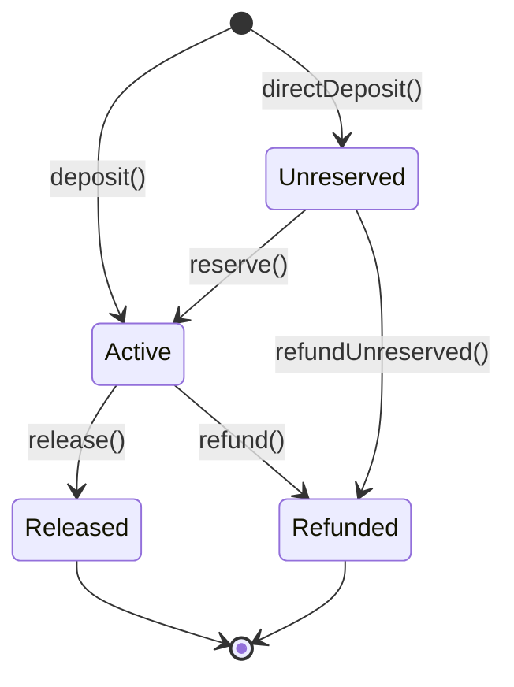

# Atum Protocol - Cross-Chain RFQ Payment System

## Overview

Atum Protocol is an intent-based payment system enabling trustless, condition-based token transfers across chains and parties. This repository contains the smart contracts for secure escrow and payment fulfillment.

The system enables users to deposit funds with specific conditions, allows competitive settlers to fulfill payments, and ensures atomic settlement through cryptographic guarantees.

> 📚 **For a complete understanding of the protocol architecture**, including off-chain components, design rationale, and operational flows, see [PROTOCOL_ARCHITECTURE.md](./PROTOCOL_ARCHITECTURE.md).
>
> 📋 **For detailed API reference and signature creation**, see [ONCHAIN_SPEC.md](./ONCHAIN_SPEC.md).

## System Design

### Protocol Flow

1. **Depositor** signs Permit2 + deposit witness offchain, specifying authorized reserver and releaser
2. **Reserver** signs reserve witness offchain to designate the settler
3. **Settler** pushes deposit transaction onchain with both signatures, locking funds with settler already set
4. **Settler** fulfills payment obligation on destination chain via FulfillmentProxy
5. **Releaser** signs release witness offchain after verifying fulfillment
6. **Settler** pushes release transaction onchain to claim escrowed funds
7. **Alternative**: Releaser signs refund witness offchain, anyone can push refund transaction to return funds to depositor

**Key Point**: On this flow depositors never interact with the blockchain directly - they only provide offchain signatures. The settler executes all onchain transactions, creating a gasless experience for depositors.

**Originator-executed (direct) deposits**: an account that cannot sign a Permit2 message (for example a Tempo access key) approves the escrow and calls `directDeposit()` itself in one batch, depositing its maximum source amount unreserved. The settler later submits `reserve()` with the reserver's signature, which charges the winning quote and refunds the rest to the depositor. Release and refund then work as above. Until `reserve()`, only the depositor can take the deposit back, alone and with no signature, with `refundUnreserved()`; the releaser cannot refund it. See ONCHAIN_SPEC.md, `directDeposit()`, `reserve()` and `refundUnreserved()`.

### Escrow Contract States

### Deposit Lifecycle

| State | Description |
|-------|-------------|
| **Unreserved** | Direct deposit before `reserve()`: refundable by its depositor alone (`refundUnreserved()`), not releasable nor refundable by the releaser |
| **Active** | Funds locked in escrow with settler designated, awaiting release or refund |
| **Released** | Funds transferred to settler upon successful fulfillment (final) |
| **Refunded** | Funds returned to depositor if fulfillment fails (final) |

## Roles

- **Depositor**: Token owner who initiates escrow deposits via Permit2 signatures
- **Reserver**: Authorized to set the settler by co-signing during deposit (cannot be changed later)
- **Releaser**: Authorized to release funds to settler OR refund to depositor
- **Settler**: Recipient of funds upon successful release (designated during deposit)
- **Owner**: Contract administrator with pause/unpause and token allowlist authority

## Contracts

### Escrow.sol
- **Purpose**: Secure token escrow with multi-party authorization and hash-based storage optimization
- **Key Features**: 
  - **Atomic deposit + reserve**: Requires both depositor and reserver signatures to create deposits with settler pre-designated
  - **Hash-based storage**: Stores `keccak256(ActiveDeposit)` instead of full structs for ~70% gas savings
  - **Unique identifiers**: `depositId` (keccak256(depositor, signature, nonce)) identifies each deposit; `quoteHash` binds it to the selected offchain quote
  - **Permit2 integration**: Gasless deposits using EIP-712 witness validation
  - **Token allowlist**: Explicit token approval with decimal validation for security
  - **EIP-712 signatures**: All state changes require typed structured signatures

### FulfillmentProxy.sol
- **Purpose**: Records payment fulfillments with on-chain audit trail linking back to escrow deposits
- **Key Features**: 
  - **Settler-initiated transfers**: `msg.sender` is always the settler (prevents spoofing)
  - **Standard ERC20 flow**: Uses approve/transferFrom pattern
  - **Batch operations**: `fulfillMany()` for gas-efficient multi-payment execution
  - **Deadline protection**: `strictFulfill()` includes timestamp validation
  - **Audit events**: Links `depositId` to fulfillment details for cross-chain verification

## Security

### Signature Security
- **EIP-712 typed data**: All operations use structured signatures with domain separation
- **Witness validation**: Full deposit data included in signatures and validated against stored hashes
- **Replay protection**: State clearing after completion prevents signature reuse
- **Unique depositIds**: Leverages Permit2's nonce bitmap for guaranteed uniqueness
- **Multi-party authorization**: Deposit requires both depositor and reserver signatures atomically

### Access Control
- **AccessControlDefaultAdminRules**: Role-based access control with safe two-step admin transfer
- **Roles**: `PAUSER_ROLE` (pause/unpause), `TREASURER_ROLE` (withdraw fees), `TOKEN_CONFIG_ROLE` (token management)
- **Pausable**: Emergency stop mechanism for all operations
- **Role separation**: Distinct reserver/releaser roles prevent single point of failure
- **Settler immutability**: Once set during deposit, settler cannot be changed

## Token Requirements

**Compatible**: Standard ERC20 tokens with fixed decimals (USDC, USDT, DAI)
**Incompatible**: Fee-on-transfer, rebasing, or deflationary tokens
**Note**: Refunds remain possible even after token removal from allowlist

## Testing

Comprehensive test coverage includes:
- **Complete flows**: deposit → release and deposit → refund paths
- **Edge cases**: Invalid signatures, witness mismatches, double-spend attempts
- **Gas optimization**: Hash-based storage validation
- **Security**: Reentrancy protection, replay attack prevention
- **Batch operations**: Multi-deposit, multi-release, multi-fulfillment scenarios

## Deployment

See **[`../deploy/README.md`](../deploy/README.md)** — the step-by-step operator guide, plus a
scripted path (`./run-all.sh`) that sequences the `script/` primitives below, checks the
preconditions they assume, and refuses on a mismatch.

Do not deploy to a real chain from a bare `forge script` invocation. The CREATE2 address is a
function of the salt, the initcode **and the deployer address** (it is a constructor argument), so
the wrong tree or the wrong compiler settings silently produce a *different, working* contract at
a *different* address rather than an error. `../deploy/` derives and asserts the expected address
before spending any gas.

Two things worth knowing before reading further:

- `script/deploy/DeployCoreContracts.s.sol` grants **no roles**. Use
  `script/deploy/DeployAndConfigureAllRoles.s.sol` for a real deployment, or you will leave the
  chain half-configured.
- There is no `[etherscan]` configuration in `foundry.toml` and no API key in this project, so
  `--verify` cannot work here. Verify separately.

## Implementation Highlights

- **Gas optimized**: Hash storage reduces costs by ~70% vs full struct storage
- **Atomic operations**: Deposit + settler designation in single transaction
- **Flexible integration**: Contracts don't directly interact, linked via events
- **Cross-chain ready**: Architecture supports multi-chain settlement flows
- **Audit-friendly**: Clear separation of concerns and extensive event logging

## Example Use Cases

### Cross-Chain Settlement
1. Alice deposits 1000 USDC on Ethereum with Bob as settler
2. Bob fulfills by sending 1000 USDT on Polygon to recipient
3. Upon verification, Alice's USDC is released to Bob on Ethereum

### Payment Intentions
1. User deposits tokens specifying conditions for payment
2. Multiple settlers compete to fulfill the intention
3. Best offer wins and executes the payment

### Trustless OTC Trading
1. Party A deposits Token X into escrow
2. Party B (settler) provides Token Y to specified recipient
3. Upon confirmation, Token X releases to Party B

## Audit Focus Areas

### High Priority Security Areas

#### 1. Protocol Fee Mechanism
**Critical**: Fees are calculated when the settler is set (at `deposit()` on the Permit2 path, at `reserve()` on the direct path, see ONCHAIN_SPEC.md) but only accumulated upon release. The contract holds both escrowed deposits AND accumulated fees in the same balance.

**Audit Points**:
- Fee calculation precision: Does the 8-decimal normalization in `Fees.sol` introduce rounding errors exploitable across different token decimals (6, 8, 18)?
- Fee/deposit accounting: Can `s_tokenFeeRevenue` ever exceed the actual fee portion of the contract's token balance? (e.g., through rounding, overflow, or manipulation)
- Withdrawal safety: Can `withdrawFeeRevenue()` ever withdraw more than accumulated fees, affecting escrowed deposits?
- Fee configuration attacks: Can a malicious TOKEN_CONFIG_ROLE holder set fee parameters (minFee, maxFee, percentage) that cause reverts on existing deposits or drain funds?
- Fee exceeds amount: The `FeeExceedsDepositAmount` check happens when the fee is calculated (`deposit()`, or `reserve()` for direct deposits) - can minFee be set higher than deposit amounts causing griefing?
- Release/refund fee consistency: Is `feeAmount` in the witness always validated against what was stored, preventing manipulation of fee deductions?
- Zero-fee edge cases: What happens with zero-fee configurations? Can fee config be changed after deposit?
- Minimum fee floor: With the atomic fallback (fee = 1 if percentage rounds to 0), could this be exploited with many small deposits?

**Files**: `src/Escrow.sol` (lines 62-63, 87, 317-325, 584-591), `src/libraries/Fees.sol`

#### 2. Token Allowlist Restrictions
**Critical**: Only explicitly allowlisted tokens with correct decimals can be deposited.

**Expected Token Support**:
- **Initial launch**: USDC and USDT on supported chains
- **Near-term expansion**: Other USD-based stablecoins
- **Future consideration** (out of scope): Non-USD stablecoins (EUR, GBP, etc.) - are any contract changes needed to support these?

**Audit Points**:
- Token compatibility: What token types should NEVER be allowlisted (fee-on-transfer, rebasing, deflationary)?
- **USD stablecoin compatibility**: Are there any popular USD-based stablecoins that would NOT be compatible with the Escrow contract? (e.g., due to non-standard ERC20 behavior, pausability, blocklists, upgradeable proxies)
- Decimal validation: Is the decimal count correctly validated and stored?
- Decimal immutability: Can token decimals change after allowlisting?
- Zero address handling: Is `address(0)` properly rejected?
- Duplicate allowlisting: What happens if the same token is allowlisted twice with different decimals?
- Removal safety: Can tokens be removed from allowlist while active deposits exist?
- Refund guarantee: Are refunds still possible after token removal from allowlist?

**Incompatible Token Types**:
- Fee-on-transfer tokens (actual transferred amount ≠ specified amount)
- Rebasing tokens (balance changes without transfers)
- Deflationary tokens (burns on transfer)
- Tokens with hooks that could cause reentrancy
- Tokens with multiple entry points or proxy upgrade risks
- Tokens with pausable transfers

**Files**: `src/Escrow.sol`, `src/interfaces/ITokenConfig.sol`

#### 3. Storage Compression Logic (Active Deposits)
**Critical**: The contract stores `keccak256(ActiveDeposit)` instead of full structs for gas optimization. Subsequent operations are performed by reconstructing this hash from witness data to verify correctness of the witness, then performing checks on the witness data as previously performed (for example, the release signature has been signed by the `releaser`).

#### 4. Dual-Signature Deposit Attack Vectors
**Critical**: Deposit requires both depositor (Permit2) and reserver signatures atomically.

**Audit Points**:
- Man-in-the-middle attacks: Can an attacker intercept one signature and manipulate the other?
- Signature replay: Can signatures be reused across different deposits or chains?
- Nonce manipulation: Can Permit2 nonces be exploited to create signature collisions?
- Front-running: Can an attacker front-run the deposit transaction with modified parameters?
- Signature malleability: Are signatures protected against malleability attacks?
- Cross-chain replay: Are signatures properly bound to chain ID and contract address?
- depositId generation: Can `keccak256(depositor, signature, nonce)` be predicted or manipulated?

#### 5. Batch Function Exploitation (`depositMany`, `releaseMany`, `refundMany`, `fulfillMany`)
**Critical**: Batch functions process multiple operations atomically. Can they be used for any attacks like reentrancy, duplicate array values, zero-values?

#### 6. Strict EIP-712 Compliance
**Critical**: All signatures must comply with EIP-712 standard for security and wallet compatibility.

**Type Hashes to Verify**:
- `DEPOSIT_WITNESS_TYPE_HASH`: `keccak256("DepositWitness(bytes32 depositRequestHash,string destination,address reserver,address releaser)")`
- `RESERVE_WITNESS_TYPE_HASH`: `keccak256("ReserveWitness(bytes32 depositId,bytes32 quoteHash,address settler,uint256 sourceAmount)")`
- `RELEASE_WITNESS_TYPE_HASH`: `keccak256("ReleaseWitness(bytes32 depositId,bytes32 quoteHash,bytes32 depositRequestHash,bytes32 destinationHash,address depositor,address token,uint256 amount,uint256 feeAmount,address reserver,address releaser,address settler)")`
- `REFUND_WITNESS_TYPE_HASH`: `keccak256("RefundWitness(bytes32 depositId,bytes32 quoteHash,bytes32 depositRequestHash,bytes32 destinationHash,address depositor,address token,uint256 amount,uint256 feeAmount,address reserver,address releaser,address settler)")`

### Additional Security Considerations

**Key Invariants to Verify**:
- Deposits can only be released OR refunded, never both
- Settler address is immutable once set during deposit
- Only allowlisted tokens can be deposited (checked at deposit time)
- Storage clearing prevents replay attacks (hash becomes `bytes32(0)`)
- Each depositId is unique (guaranteed by Permit2 nonce + signature combination)
- Permit2 nonces are consumed, preventing signature reuse
- Token balances exactly match escrowed amounts (no fee-on-transfer)

**State Machine Safety**:
- Active → Released: Only via valid releaser signature
- Active → Refunded: Only via valid releaser signature
- Unreserved direct deposit (before `reserve()`) to Refunded: Only by the depositor itself, via `refundUnreserved()`
- Released/Refunded → (cleared): Storage deleted, cannot transition further
- Paused state: All operations blocked except view functions and unpause
