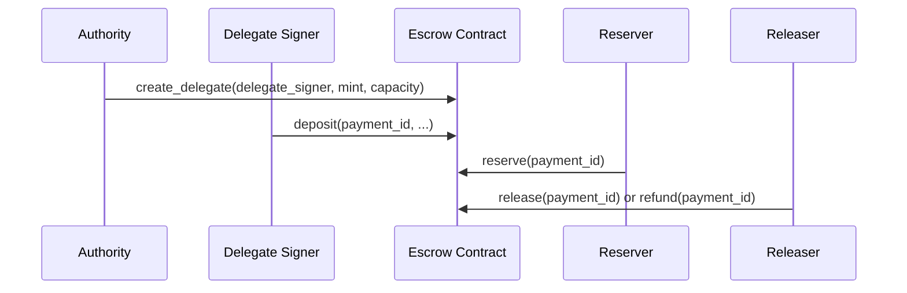

# Solana Escrow

A secure and flexible escrow program on Solana, designed to hold funds in a program-controlled
account, enabling multi-party authorization for fund release or refund based on off-chain Ed25519
signatures.

## Features

- **Multi-party Authorization**: Separate roles for depositor, reserver, and releaser
- **Delegated Deposits**: Off-chain signers can authorize deposits on behalf of authorities
- **Protocol-Bound Signatures**: Escrow messages are domain-separated by program ID, `cluster_id`, and on-chain schema version
- **Replay Protection**: Bitmap-based mechanism prevents duplicate transactions
- **Exact Settlement**: `release` settles only the intended deposit amount and returns surplus to the depositor
- **PDA Support**: Program Derived Addresses as depositors, settlers, and recipients
- **Fulfillment Proxy**: Token transfer program with deadline and replay protection

## Prerequisites

| Tool    | Version   | Notes                                                                                                                                                      |
| ------- | --------- | ---------------------------------------------------------------------------------------------------------------------------------------------------------- |
| Rust    | stable    | Via [rustup](https://rustup.rs)                                                                                                                            |
| Solana  | **2.3.0** | `sh -c "$(curl -sSfL https://release.anza.xyz/v2.3.0/install)"` — Solana 3.x is **not** compatible with Anchor 0.32.1 (Token-2022 TransferHook CPI breaks) |
| Anchor  | 0.32.1    | Via AVM: `cargo install --git https://github.com/coral-xyz/anchor avm && avm install 0.32.1 && avm use 0.32.1`                                             |
| Node.js | 18+       |                                                                                                                                                            |
| pnpm    | 10.x      | `npm install -g pnpm`                                                                                                                                      |

## Quick Start

```bash
# Clone repository
git clone git@github.com:Atum-Labs/solana-escrow.git
cd solana-escrow

# Install dependencies
pnpm install

# Sync program IDs with local keypairs (required after fresh clone)
anchor keys sync

# Build programs
anchor build

# Run tests
anchor test
```

## Documentation

Full documentation is available in the [docs/](docs/) directory:

- **[Getting Started](docs/getting-started/quickstart.md)** - Setup and configuration
- **[Architecture](docs/architecture/overview.md)** - System design and security model
- **[Programs](docs/programs/escrow.md)** - Instruction reference
- **[Development](docs/development/setup.md)** - Local setup and testing
- **[Deployment](docs/operations/deployment.md)** - Production deployment guide

## Program IDs

| Program           | ID                                             |
| ----------------- | ---------------------------------------------- |
| Escrow            | `F9mjwmRfYWVUJPwSm3ygG7c9Pq2JF2eqpHC6MpVffV85` |
| Fulfillment Proxy | `679cgQsBfvGLbeJutpRmJvEZtx5pWsXxwN6cGJggMjSx` |

## Architecture Overview



## Contributing

See the [Contributing Guidelines](docs/development/contributing.md) for details on code style,
testing requirements, and pull request process.

## License

[License information]
