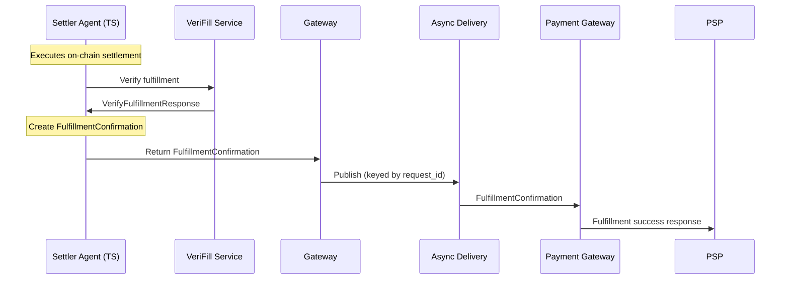

# FulfillmentConfirmation API Schema v1

## Overview

The `FulfillmentConfirmation` schema defines the structured response message sent by settler agents after successfully completing on-chain fulfillment operations. This schema enables proper correlation and confirmation of cross-chain stablecoin payments within the Atum network.

## Purpose

This schema serves as an API message type, representing the successful completion of:

- **Escrow Reservation**: On the source chain where funds are reserved
- **Fulfillment Execution**: On the destination chain where assets are delivered  
- **Verification Process**: Cryptographic proof that both operations completed successfully

## Schema Architecture

### Core Fields

- `payment_id` - unique identifier for correlation with original request
- `request_id` - original request ID from the payment submission
- `source_chain_id` / `destination_chain_id` - CAIP-2 chain identifiers
- `source_tx_hash` / `destination_tx_hash` - blockchain transaction hashes (required)
- `fulfillment_timestamp` - optional timestamp of completion
- `source_block_number` / `destination_block_number` - optional block numbers for confirmation tracking

## Usage Flow

1. **Settler Agent Execution**: Completes escrow reservation and fulfillment transactions
2. **Verification Service**: Calls veri-fill service to verify fulfillment 
3. **Confirmation Generation**: Creates FulfillmentConfirmation message with all settlement data
4. **Webhook Response**: Returns structured confirmation to the gateway
5. **Delivery**: The gateway delivers the confirmation asynchronously, keyed by `request_id`
6. **PSP Response**: Payment Gateway consumes the confirmation and responds to the waiting PSP

## Message Flow Integration



## Generated Bindings

- To generate the bindings run `make generate-fulfillment-confirmation`

### **Go Bindings** (`bindings/go/types.go`)
- Package: `fulfillmentconfirmation`
- Struct: `SchemaJson` - represents the complete message
- Enums: `FulfillmentError` - error codes with constants
- Validation: Built-in JSON unmarshaling with validation

### **TypeScript Bindings** (`bindings/typescript/`)
- Interface: `FulfillmentConfirmation` - main message interface
- Type: `FulfillmentError` - union type for error codes  
- Subinterfaces: `VerificationDetails`, `SettlementAmounts`
- Build: Compiled to CommonJS with type declarations

## Integration Examples

### **Settler Agent (TypeScript)**
```typescript
import { FulfillmentConfirmation } from '@atum-labs/fulfillment-confirmation';

const confirmation: FulfillmentConfirmation = {
  payment_id: depositId,
  request_id: requestId,
  source_chain_id: `eip155:${sourceChainId}`,
  destination_chain_id: `eip155:${destinationChainId}`,
  source_tx_hash: reservationTxHash,
  destination_tx_hash: fulfillmentTxHash,
  fulfillment_timestamp: new Date().toISOString(),
  source_block_number: sourceBlockNum,
  destination_block_number: destBlockNum,
};
```

### **Gateway (Go)**
```go
import fulfillmentconfirmation "schemas/apis/fulfillment-confirmation/v1/bindings/go"

func handleWebhookResponse(body []byte) (*fulfillmentconfirmation.SchemaJson, error) {
    var confirmation fulfillmentconfirmation.SchemaJson
    if err := json.Unmarshal(body, &confirmation); err != nil {
        return nil, err
    }
    return &confirmation, nil
}
```

## Validation Rules

### **Required Fields**
- Must include `payment_id`, `request_id`
- Must include both chain IDs: `source_chain_id` and `destination_chain_id`
- Must include both transaction hashes: `source_tx_hash` and `destination_tx_hash`
- Chain IDs must follow CAIP-2 format (`^[a-z0-9]+:[a-zA-Z0-9_-]+$`)

### **Transaction Hashes**
- Must be valid transaction hashes (`^(0x[a-fA-F0-9]{64}|[1-9A-HJ-NP-Za-km-z]{32,88})$`)
- Supports 0x-prefixed hex (EVM) and base58 formats
- Both source and destination hashes are required for full settlement proof

### **Optional Fields**
- `fulfillment_timestamp` - ISO 8601 format with timezone, used for audit trails
- `source_block_number` / `destination_block_number` - integers >= 0, used for confirmation tracking
