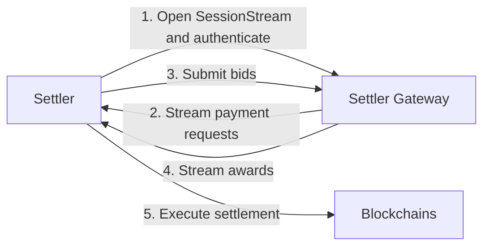
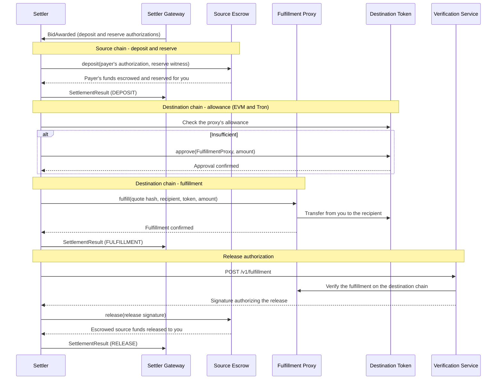

# Settler Gateway — SessionStream Integration Guide

This is the wire contract a settler agent uses to talk to the Atum Settler Gateway: a single
bidirectional gRPC stream (`SettlerGatewayService.SessionStream`, defined in
[`settler.proto`](./settler.proto)) that carries authentication, subscription, bid submission,
settlement reporting, and every lifecycle event, multiplexed over one long-lived connection.

It is also the integration guide: alongside the stream contract it covers the on-chain
settlement that a won bid commits you to, and the one call you make outside the stream.

## Contents

- [What a settler does](#what-a-settler-does)
- [Prerequisites](#prerequisites)
- [The two payment flows](#the-two-payment-flows)
- [Identifiers](#identifiers)
- [Connecting and authenticating](#connecting-and-authenticating)
- [Subscribing to assets and corridors](#subscribing-to-assets-and-corridors)
- [Reconnecting and replay](#reconnecting-and-replay)
- [Signing: quotes, credentials, and envelopes](#signing-quotes-credentials-and-envelopes)
- [Bidding](#bidding)
- [Declining to bid](#declining-to-bid)
- [Handling an award](#handling-an-award)
- [The settlement transactions](#the-settlement-transactions)
- [Getting paid: the release authorization](#getting-paid-the-release-authorization)
- [Reporting fulfillment authorization](#reporting-fulfillment-authorization)
- [Reporting settlement outcomes](#reporting-settlement-outcomes)
- [Message size limits](#message-size-limits)
- [Working with embedded JSON](#working-with-embedded-json)
- [Bindings](#bindings)
- [Related schemas](#related-schemas)

## What a settler does

A settler is a liquidity provider. It watches for cross-chain payment requests on corridors it
supports, quotes a price to fulfill them, and — when its quote is chosen — executes the on-chain
transactions that deliver funds to the recipient, then claims the escrowed source funds as payment.

Everything Atum sends the settler, and everything the settler reports back, travels over this one
stream. There is no polling API and no inbound HTTP callback to implement: the settler opens the
stream outbound, and it stays open. The one call a settler makes outside the stream is to the
verification service, to obtain its release authorization after fulfilling — see
[Getting paid: the release authorization](#getting-paid-the-release-authorization).



## Prerequisites

Before writing code you need:

- **A signing wallet per chain you settle on.** The same key signs your wallet proof (to
  authenticate), your quotes, and the settlement transactions. Atum matches quotes against the
  address that signed them, so the account must be the one holding your liquidity.
- **The corridors you support**, as [CAIP-19](https://github.com/ChainAgnostic/CAIPs/blob/main/CAIPs/caip-19.md)
  asset identifiers (for example `eip155:1/erc20:0xa0b8...`) — source asset → destination assets.
  This drives your subscription.
- **An Atum-issued credential** (see [Signing](#signing-quotes-credentials-and-envelopes)). Atum
  issues this out of band during onboarding; it is what lets the gateway confirm it recognizes your
  signing key, so request it early.
- **Your gateway host and environment** (testnet or mainnet), provided by Atum during onboarding.
  The environment also determines the `domain` value you sign into presentations, so testnet
  credentials and signatures do not carry over to mainnet.

## The two payment flows

Atum supports two ways for a payer to buy settlement. Both run an auction, both use the same two
events (`AuctionOpened` to ask for your bid, `BidAwarded` to tell you that you won), and both use
identical bidding mechanics. What differs is how committed the payer is at the moment you are asked
to quote, and you can read that off the request itself.

**Some payers are shopping.** A client integrating with Atum alongside other payment providers wants
to compare real prices before deciding where to route a payment. The Quote API exists for them: they
ask for quotes, get real numbers back, and are bound to nothing. Many of those requests will never
become payments — not because anything failed, but because the payer routed elsewhere or changed
their mind. Your quote is an option they may simply not exercise.

**Some payers have already committed.** A single-call payment request arrives with `sender_auth`
attached — the payer's signed deposit authorization over their own funds. That is a much
stronger signal: they have authorized real money to move, and the only open question is which settler
fulfills it.

That difference is economic, not cosmetic, and it is a legitimate business decision to treat the two
differently. A settler that only wants firm demand can bid only on requests that already carry a
`payment_id` and decline the rest — you are not obliged to answer speculative price checks. A settler
that does quote should price the `award_deadline` window it is holding, because it is writing an
option rather than closing a sale.

The identifiers on `AuctionOpened` tell you which situation you are in:

| The request carries | Meaning |
|---|---|
| `payment_id` | The payer has attached the deposit authorization (`sender_auth`) to the embedded `PaymentRequest`. Real money is authorized to move and a settlement key already exists. |
| `quote_request_id` | The payer is collecting quotes for a batch and has authorized nothing yet. The embedded `PaymentRequest` carries no `sender_auth`; an award, if one comes, brings the `payment_id` and the authorization. |

Exactly one of the two is set. Echo the one you received in `SubmitBid` (or `BidDeclined`). An event
carrying neither, or both, is malformed: do not bid on it, and do not send `BidDeclined` either — a
decline correlates on the same identifier, so there is nothing to attribute it to. Log it and move on.

### Single-call payment flow

The originator submits a fully-authorized payment in one request (`POST /v1/payments`), including
the payer's deposit authorization (`sender_auth`). The gateway opens an auction, collects bids,
**selects the winner itself — the lowest `source_amount` wins**, earliest bid breaking a tie — and
notifies that settler. The payer never chooses manually.

```
gateway                          settler
  AuctionOpened  ───────────────>            (payment_id set)
                 <───────────────  SubmitBid            (payment_id echoed)
  BidRefused     ───────────────>            (instead, if the bid is refused for its quote)
  BidAwarded     ───────────────>            (you won)
                 <───────────────  SettlementResult     (one per settlement transaction)
  SettlementResultAck ──────────>            (when settlement_result_acks is true)
```

If nobody wins, the auction simply ends at the deadline carried in the request — you already know
when your window closes, so nothing needs to tell you.

### Quote API

Quoting and committing are split, so the payer can see real prices before spending anything.

**Phase one — collect quotes** (`POST /v1/payments/quote-requests`). No deposit and no
`sender_auth` — a quote-request carrying one is rejected, which is the exact inverse of the
single-call flow, where it is required. Quotes are collected and surfaced to the originator.

```
gateway                          settler
  AuctionOpened  ───────────────>            (quote_request_id set; no payment_id, no deposit exists yet)
                 <───────────────  SubmitBid            (quote_request_id echoed)
  BidRefused     ───────────────>            (if the bid is refused for its quote)
```

**Phase two — award** (`POST /v1/payments/awards`). The originator picks one quote and only then
authorizes the payment: the deposit authorization for exactly that quote's `source_amount`, and a
reserve message naming the chosen settler, signed by the reserver the deposit authorization names.
That surfaces to the winner as `BidAwarded` carrying the `payment_id` for the **first** time, the
`quote_request_id` it answers, the deposit authorization in `sender_auth_json` and the reserve
message in `reserve_msg`.

```
gateway                          settler
  BidAwarded     ───────────────>            (payment_id appears here for the first time; quote_request_id set)
                 <───────────────  SettlementResult     (one per settlement transaction)
  SettlementResultAck ──────────>            (when settlement_result_acks is true)
```

Only the winner hears anything. There is no "not selected" event: a quote that is not awarded simply
expires at its `award_deadline`, so treat silence as the normal outcome for most quotes.

One consequence specific to this flow: **a quote is an option, not a sale.** Your quote's
`award_deadline` is your own signed price hold: the window in which the originator may still award
it. Nothing obliges them to. Price the window, and keep it short enough that you are not quoting
stale liquidity.

Once awarded, settlement is identical in both flows: deposit and reserve on the source chain →
fulfill on the destination chain → obtain the release authorization → release. Whether the reserve
rides inside the deposit call or is a separate instruction depends on the source chain's escrow.

## Identifiers

Several ids travel with a payment. They are not interchangeable, and using the wrong one as a
lookup key is the most common early integration mistake.

| Identifier | Who creates it | What it keys | Present on this stream |
|---|---|---|---|
| `payment_id` | Gateway, derived from the deposit authorization | **The settlement key.** The escrow deposit handle; use it for all settlement state and reporting. | On every `BidAwarded`. On `AuctionOpened` when the payer has already attached the deposit authorization. |
| `quote_request_id` | Gateway | **The quote-batch handle.** Correlates the request, your `SubmitBid`, and the award. | On `AuctionOpened` and `BidAwarded` for quote batches; empty otherwise. |
| `request_id` | The originator | The originator's own idempotency key for its API call. Not a settlement key. | Only inside the embedded `PaymentRequest` JSON. |
| `agent_id` | Gateway, at handshake | Your connected agent instance. Returned in `InitAck`. | Yes. |
| `settler_id` | Agreed with Atum at onboarding | Your settler identity. One input to the award binding. | On `BidAwarded`. |
| `sequence_id` | Gateway | Your replay cursor (per-agent, 1-indexed, monotonic). | On every `SessionEvent`. |
| `global_sequence_id` | Gateway | System-wide counter, for cross-referencing with Atum when debugging. Not a replay cursor. | On every `SessionEvent`. |
| `quote_hash` | Derived (content hash) | Binds signatures to a specific quote. **Not an identifier** — never index by it, look records up by it, or put it on-chain. | On `BidAwarded`. |

`payment_id` is a 32-byte hash, hex-encoded with an `0x` prefix:

```
0x37ee108721b3ab4eba33df421290249381f00d0084dd6fae7d4061ad7eacd9bd
```

Because it is derived from the deposit authorization, it cannot exist before that authorization does.
That is precisely why a quote-batch request carries no `payment_id`, and why its `BidAwarded` is the
first place the id appears. The derivation is chain-specific; a settler never needs to compute it,
and should always take it from the event rather than deriving or reformatting it.

If you come across `auction_id` or `transfer_id` elsewhere, neither is part of this contract: they do
not appear on this stream or in any payload delivered to a settler. Use `payment_id` to key
settlement and `quote_request_id` to correlate a quote batch.

## Connecting and authenticating

Open the bidirectional `SessionStream` RPC. Your first message MUST be a `SessionInit`:

| Field | Purpose |
|---|---|
| `agent_domain` | Identifies this agent instance: `<organization>:<role>:<version>`, e.g. `"acme:main:1.0"`. Bound into every wallet-proof signature. |
| `wallet_proofs` | One `WalletProof` per chain you will act on. |
| `subscription` | Your `SubscriptionConfiguration` — see [Subscribing](#subscribing-to-assets-and-corridors). |
| `from_sequence_id` | Replay point — see [Reconnecting](#reconnecting-and-replay). |

Each `WalletProof` proves control of a wallet without revealing the key:

```
message   = hex(SHA-256(JCS({ address, agent_domain, chain_id, timestamp })))
signature = sign(message)   // the 64-char lowercase hex STRING, not the 32 digest bytes
```

- **You sign the hex string, not the digest bytes.** This is the single easiest thing to get wrong:
  signing the 32 raw bytes produces a valid-looking signature that fails verification every time.
- `JCS` is JSON Canonicalization Scheme ([RFC 8785](https://www.rfc-editor.org/rfc/rfc8785)), which
  fixes key order and number formatting so both sides hash identical bytes.
- `chain_id` is a CAIP-2 identifier (`"eip155:1"`, `"solana:5eykt4UsFv8P8NJdTREpY1vzqKqZKvdp"`).
- `timestamp` is Unix milliseconds, canonicalized as a JSON **number** (not a string), and must match
  the value you send in the `WalletProof`.
- `agent_domain` binds the proof to this agent instance, so it cannot be replayed by another agent.

The signature itself uses your chain's own message-signing scheme, always over that hex string:

| Chain | Scheme |
|---|---|
| EVM | EIP-191 `personal_sign` — prefix `\x19Ethereum Signed Message:\n` |
| Tron | TIP-191 — prefix `\x19TRON Signed Message:\n` |
| Solana | raw Ed25519 over `"settler-agent:gw-handshake:v1\n" + message` |

The Solana domain string is matched exactly, including its trailing newline and version suffix.

The gateway replies with exactly one `InitAck`:

- **`success: true`** — keep `agent_id`, `server_version`, `latest_sequence_id` and
  `settlement_result_acks`. Compare `latest_sequence_id` against your own last-processed sequence to
  detect a gap after a reconnect. `settlement_result_acks` says whether this gateway acks each
  `SettlementResult` (see [Acknowledged reports](#acknowledged-reports)).
- **`success: false`** — read `error_code` (for example `AUTHENTICATION_FAILED` when a wallet proof
  does not verify, or `HANDSHAKE_FAILED` when your first message is not a `SessionInit`) and
  `error_message`, fix the cause, reconnect. Retrying an identical rejected handshake will not
  succeed.

A `SessionInit` over the [message size limit](#message-size-limits) gets no `InitAck`: the stream
closes with `RESOURCE_EXHAUSTED`.

Send a `Heartbeat` periodically to keep the session alive; the gateway answers with `HeartbeatAck`.
Agree the interval with Atum during onboarding.

## Subscribing to assets and corridors

`SubscriptionConfiguration` decides which requests you are shown:

- **`asset_filters`** — per asset, an `AssetCorridors` map from each source CAIP-19 asset you accept
  to the destination CAIP-19 assets you can deliver. A request outside this set is never offered.
- **`allowed_fulfillment_verifiers`** — restrict which verifier accounts you will accept.
  Empty means accept all.

The subscription is set once, in `SessionInit`; there is no in-stream update message. To change
corridors, reconnect with a new `SessionInit`. The gateway confirms the active configuration with a
`SubscriptionUpdated` event, and the `sequence_id` it arrives at marks the point from which the new
configuration applies.

## Reconnecting and replay

Every `SessionEvent` carries a per-agent `sequence_id`, 1-indexed and monotonically increasing.
Persist the last one you fully processed. On reconnect, set `from_sequence_id`:

| Value | Behavior |
|---|---|
| `-1` | Skip replay; receive only new events. |
| `0` | Replay everything from the beginning. |
| `> 0` | Replay from this sequence id, inclusive. |
| `< -1` | Rejected. |

Upstream messages (`SubmitBid`, `FulfillmentAuthorized`, `BidDeclined`) are **fire-and-forget —
there is no acknowledgement**. `SettlementResult` is the exception when
`InitAck.settlement_result_acks` is true: see [Acknowledged reports](#acknowledged-reports). A
`SubmitBid` refused for its quote, once the quote has passed verification, is answered with a
`BidRefused`: see
[Refused bids](#refused-bids). Replay
covers gateway→settler events only, so if the stream drops mid-send, re-derive what still needs
sending from your own persisted settlement state rather than expecting the gateway to ask again.
Persist before you send, and make your handlers idempotent: a replayed event may be one you already
acted on.

## Signing: quotes, credentials, and envelopes

Atum is an identity-first network: it verifies not just *what* was signed, but *who* signed it and
*under what authority*. A bare signature proves you hold a key; it does not prove Atum recognizes
that key, nor that the signature was minted for this specific quote in this specific environment.
Two layers close that gap.

**Layer 1 — the signed quote.** Your `FulfillmentQuote` carries a W3C Data Integrity `proof`,
signed by your settler key. The gateway recovers the signer, checks proof freshness, checks that the
cryptosuite matches the chain, and checks the recovered address against the settlers it knows.

Cryptosuite is determined by the chain, not by preference:

| Chains | Cryptosuite |
|---|---|
| EVM, Tron | `EcdsaSecp256k1RecoverySignature2020` |
| Solana | `Ed25519Signature2020` |

**Layer 2 — the envelope (`FulfillmentQuoteEnvelope`).** A W3C Verifiable Presentation wrapping the
signed quote, sent in `SubmitBid.presentation`. It adds three bindings:

- **Holder** — `holder` is `did:pkh:<chain>:<your-account>` and MUST be the same account that signed
  the inner quote. The verifier asserts equality after independently verifying both proofs.
- **Replay** — `proof.proofPurpose` is `authentication`; **`proof.challenge` is the canonical
  `quote_hash` of the signed quote** (use the `computeQuoteHash` / `ComputeQuoteHash` helper — do not
  re-derive it by hand); `proof.domain` is the service identifier for the environment you are
  connecting to, which Atum gives you during onboarding. Together these stop a captured envelope from
  being replayed against a different quote or in a different environment.
- **Credentials** — `verifiableCredential` carries the Atum-issued credential naming you as a
  settler. The gateway checks that it comes from an issuer it recognizes, that its subject is your
  holder DID, that it is currently valid, and that the issuer's own signature verifies. This
  credential is issued to you out of band; you cannot mint it yourself.

> **Gotcha:** the envelope's `@context` MUST include **both** the W3C VC v1 context and the
> `FulfillmentQuoteEnvelope` v1 context. Without the latter, JSON-LD expansion silently drops
> `challenge`, `domain`, and `holder` during canonicalization, so those fields end up outside the
> signature and verification fails in a way that is hard to diagnose. Use the provided signing
> libraries and this is handled for you.

**Send a valid presentation with every bid.** Treat it as a required part of a bid rather than an
optional extra: a bid whose envelope is missing or fails verification may be rejected, and rejection
is silent on this stream.

**Signed reports.** `SettlementResult` and `BidDeclined` are attested the same way. Each carries a
declaration as raw JSON (`settlement_result_json`, a `SettlementResult/v1`; `bid_decline_json`, a
`BidDecline/v1`) and, in `presentation`, a VP over it:

- **Declaration** — every field is a required string, `""` when absent. Enum values drop their
  prefix (`phase` `DEPOSIT`, `outcome` `FINALIZING`, `reason_code` `DEADLINE_TOO_SHORT`) and
  `block_number` is a decimal string. Every protobuf scalar on the message MUST equal its declared
  value, except the `BidDeclined.reason` enum, which an older reader may not know (`reason_code`
  carries the reason), and the gateway reads every field it acts on from the declaration.
- **Envelope** — a `SettlementResultEnvelope` or `BidDeclineEnvelope`: `type` names it, `holder` is
  the `did:pkh` of the same chain key you sign quotes and bids with (for a `SettlementResult`, the
  key that signed the awarded quote), `proof.challenge` is the declaration's content hash
  (`ComputeSettlementResultHash` / `ComputeBidDeclineHash`, built on `ComputeContentHash` /
  `computeContentHash`), and `proof.domain` is the same service identifier your bid envelopes carry.

**Sign every report.** Treat the presentation as required, as for bids: a report whose declaration
or envelope is missing or fails verification may be rejected. A rejected `BidDeclined` gets no
answer. When `settlement_result_acks` is true, a rejected `SettlementResult` is answered `REJECTED`
with `reason_code` `invalid_vp:<vp reason code>`. Sign a report once and resend the same bytes on
every retry. If signing fails, retry it. Send the report with `presentation` and its declaration
empty only as a last resort. A declared string holding a raw TAB cannot be hashed, so keep TABs out
of `message` and `error_json`.

Signing and verification are implemented for you, with cross-language conformance fixtures pinning
Go and TypeScript to byte-equal output:

| | Go | TypeScript |
|---|---|---|
| Package | `.../declarations/FulfillmentQuote/v1/bindings/go/signing` | `@atum-labs/ld-signing` |
| Sign quote | `Sign`, `SignEd25519` | `signQuote`, `signQuoteEd25519` |
| Sign envelope | `SignVP`, `SignVPEd25519` | `signVP`, `signVPEd25519` |
| Verify | `Verify`, `VerifyVP` | `verifyQuote`, `verifyVP` |
| Quote hash | `ComputeQuoteHash` | `computeQuoteHash` |

## Bidding

Bid by sending `SubmitBid` with your signed `FulfillmentQuote` JSON in `metadata` and its envelope in
`presentation`. Echo the identifier the request carried: `payment_id` or `quote_request_id`.

Your quote must carry, at minimum, the `source_amount` you are charging, the `award_deadline` you are
holding that price until, your `settler_address`, the `source` and `destination` assets, and the
`payment_request_json` it responds to. Credentials belong in the envelope, not in the quote body.

Bids are fire-and-forget: there is no acknowledgement, and a bid that loses is simply never awarded.
Most rejected bids produce no reply either, so verify your own quotes and envelopes locally with the
`verify` helpers before sending. That is far easier to debug than an unexplained absence of awards.
A `SubmitBid` over the [message size limit](#message-size-limits) closes your stream.

### Refused bids

The gateway answers a bid it refuses for its quote, once the quote has passed verification, with a
`BidRefused`: for the terms the quote commits, for failing the FulfillmentQuote schema, or for
carrying a credential inside the quote. It names the bid by the `payment_id` or `quote_request_id`
it carried and by its quote's `quote_hash`, so a settler
that sent more than one bid for the same auction knows which one was refused. The
bid was not published, so it cannot be awarded, and the same quote sent again is refused again. Other
refusals still produce no reply. That includes a quote or envelope that fails verification, and a
quote the gateway cannot read at all: unparseable, missing a required member, or with a bad
`version` or `source_amount`.

| `reason_code` | Meaning | What to do |
|---|---|---|
| `quote_request_mismatch` | The quote's `payment_request_json` commits other terms (depositRequestHash v2) than the request the auction was opened with. | Quote that request, verbatim or re-encoded. |
| `request_malformed` | The strict request reader refuses the quote's `payment_request_json`. | Fix the copy you embed. |
| `stored_request_malformed` | It refuses the auction's own request. | Don't bid: no quote can win this auction. |
| `quote_schema_invalid` | The quote passed verification but fails the FulfillmentQuote v1 JSON Schema, such as a `null` `settler_address`, or carries a non-empty `verifiableCredential` of its own (credentials go in the envelope). `message` names the failing members. | Fix the quote so it passes the schema, with its own `verifiableCredential` set to `[]`. |
| anything else | A refusal. | Treat it as one. |

`message` is human-readable detail for logs, at most 256 bytes; never parse it. Refusals are not
replayed, and a gateway that predates `BidRefused` sends none, so silence never means a bid was
accepted.

On the single-call flow you compete purely on `source_amount`. On the Quote API someone may be
comparing your quote against other providers' side by side, so the `award_deadline` you offer is part
of the offer, not just an expiry.

## Declining to bid

When you decide not to bid, send `BidDeclined` rather than staying silent. Either way the payment gets
no quote from you, but a decline is what lets Atum tell the payer *why* no quote came back, and how
many settlers the request actually reached. Without it, a payer whose request found no liquidity
cannot be told anything useful about the reason.

Set `reason` to the value that names your actual cause, and **always** put the specific detail in
`message`. Each value stands for one cause with one fix, so resist reaching for a near miss: a reason
nobody can act on is worth less than no reason at all. When nothing fits,
`DECLINE_REASON_HOOK_DECLINED` is the catch-all that carries settler-authored free text in `message`.
Mirror `SubmitBid` for the ids: echo the one the request carried. A `BidDeclined` over the
[message size limit](#message-size-limits) closes your stream.

## Handling an award

`BidAwarded` carries everything needed to settle, whichever way the payment was bought:

- `payment_id` — your settlement key.
- `metadata` — the full `BidAward` JSON.
- `sender_auth_json` — the payer's deposit authorization: the `sender_auth` object of the
  `PaymentRequest`, as JSON. Build the deposit from this field. It is populated on every award the
  gateway emits today, and is the only carrier for an award answering a quote batch. It may be empty
  on an award from a gateway build predating the field; until those are out of service, fall back to
  the copy inside the `PaymentRequest` embedded in `metadata`. **That fallback is transitional and
  will be removed** — do not build on it as a permanent second source. An award with the
  authorization in neither place cannot be settled.
- `reserve_msg` — the pre-signed reserve authorization naming you, with a hash, a signature, and
  the signed pre-image: the typed data on EVM and Tron, the reserve record on Solana. It is signed
  by the reserver the deposit authorization names.
- `refund_msg` — reserved for a pre-signed refund authorization; currently always empty. The refund
  authorization is obtained from the verification service, see
  [Getting paid: the release authorization](#getting-paid-the-release-authorization).
- `quote_request_id` — set when the request was a quote batch. Correlate it with your bid; never use
  it as a settlement key.
- `created_at` — emission time, for observability only.
- `presentation`, `quote_hash`, `settler_id` — the award authority binding, below.

**Check the authorization before depositing.** `sender_auth_json` is forwarded by the gateway and is
not covered by your own quote signature. Verify that the deposit signature inside it was produced by
the request's `source.account` — recover the signer on EVM and Tron; on Solana, check the depositor
named in the signed pre-image — and reject the award on a mismatch. That turns a substituted
authorization into an explicit failure on your side instead of an on-chain revert.

The release authorization is not delivered on the stream — fetch it from the verification service
after your fulfillment transaction confirms, as described in
[Getting paid: the release authorization](#getting-paid-the-release-authorization).

**Verify the award before spending gas.** The award carries a presentation proving an authorized
party approved it. To check it:

1. Verify the presentation's proof.
2. Recompute `award_hash(payment_id, quote_hash, settler_id)` using the
   `ComputeAwardHash` / `computeAwardHash` helper (`@atum-labs/award-hash`, or the
   `BidAwardEnvelope` Go signing package) and assert it equals the presentation's `proof.challenge`.
3. **Separately assert that `quote_hash` equals the canonical hash of the quote you are about to
   settle.** Step 2 alone proves an authorized party signed *some* `(payment_id, quote_hash,
   settler_id)` tuple; it does not prove the `BidAward` metadata you received is the quote that hash
   refers to. Without step 3, swapped metadata would still pass the challenge check.

`award_hash` is a signature-binding value, not an identifier: an equal hash does not imply a valid
signature, so never treat it as a lookup key or commit it on-chain.

The award authority is whoever selected the winning quote; the binding you verify is the same either
way. An award may arrive without these fields populated, so gate the check on their presence rather
than rejecting every award that lacks them.

Deadlines come from the absolute `fulfillment_deadline` inside the signed `BidAward` /
`PaymentRequest`, **never** from an event's `created_at`, which is emission time for observability
only.

## The settlement transactions

Once you hold a verified award, the on-chain work is yours to drive. Three transactions move the
money — deposit, fulfill, release — and a fourth, the refund, returns the escrowed funds to the
depositor if you never fulfill.



**Source chain — the escrow.** You submit the deposit; the payer does not. The call carries the
payer's own deposit authorization — `sender_auth`, inside the embedded `PaymentRequest` — together
with the reserve witness the award handed you as `reserve_msg`, so the funds are escrowed and
reserved for you in a single transaction, which is why one `DEPOSIT` phase covers both. Whether the
reserve rides inside the deposit call or is a separate instruction bundled into that transaction
depends on the source chain's escrow; either way it lands atomically with the deposit, and a reserve
that names a different settler is worth nothing to you. `release()` later claims those funds; if the
fulfillment deadline passes first, a refund returns them to the depositor instead. Both need an
authorization from the verification service, below.

**Destination chain — the fulfillment proxy.** `fulfill` moves your own tokens to the recipient and
emits the event the verification service reads, binding the transfer to your quote hash. On EVM and
Tron the proxy moves them with `transferFrom`, so it needs an allowance over your token first —
check it and top it up before fulfilling. On Solana you are the transfer authority and sign the
transfer yourself, so there is no allowance step. Fulfill with your own liquidity: nothing is
advanced to you, and the escrowed source funds stay locked until the release.

## Getting paid: the release authorization

Releasing the escrowed source funds to yourself requires a signature from the verification service.
It is not handed to you up front, and deliberately so: it is issued *only* after the service has
independently confirmed on the destination chain that your
fulfillment actually happened and matches the payment. That check is what protects the payer, and it
is why the release authorization cannot exist before you fulfill.

The call is a single `POST /v1/fulfillment` against the verification service, documented in
[veri-fill/v1/openapi.yaml](../../../veri-fill/v1/openapi.yaml) with generated Go and TypeScript
clients alongside it. Your environment's host is part of your onboarding inputs; the spec lists the
per-environment hosts.

You identify the payment and point at your fulfillment transaction — `payment_id`,
`transaction_hash`, and the awarded `fulfillment_quote`, plus the witness fields the spec marks
required. The service takes the delivery terms, the chains and the escrow from the verified quote
and its own chain configuration. `transaction_hash` is the authoritative locator: an EVM
transaction hash, a Tron transaction id, or a Solana signature.

A successful response returns `verified: true` and a `signature` authorizing the escrow `release()`,
along with `message_hash` and `message_prehash` so you can check what was signed before submitting
it. The signature is encoded for the **source** chain, where the release happens — not the chain you
fulfilled on: `0x`-prefixed hex on EVM and Tron, bare hex on Solana. Normalize it rather than
assuming a prefix either way. Check that the `payment_id` in the response matches the one you asked
about before using the signature.

Three things to get right:

- **Call it once your fulfillment transaction is mined.** The service reads the destination
  chain and answers `verified: false` until the transaction is final there, which on some
  chains takes minutes. `GET /v1/finality-config` says how long to expect per chain.
- **`verified: false` means "not yet", not "rejected".** It comes back with HTTP 200, and the usual
  cause is simply that you asked before the chain caught up. Retry it with backoff. Do not abandon
  the payment on it — you have already delivered funds on the destination chain, and giving up on a
  fulfillment that merely has not surfaced yet is how a settler loses money it has already spent.
- **Use `details` to decide when to stop retrying.** The `error` code on a non-verified response is
  coarse; `details` carries the specific reason. A reason that your transaction is not found or not
  final yet resolves on its own. An amount that does not match what the payment expected never
  will — that needs investigation, not another attempt.

Errors are shaped differently from a non-verified result: any 4xx or 5xx carries the shared
`AtumError` envelope instead of the response above, so classify on HTTP status first and parse the
body accordingly.

**The fulfillment deadline applies to delivery, not to release.** Past it the escrow becomes
refundable to the depositor, so a late delivery is funds you may never recover: treat the deadline
as a hard commitment when you decide whether to bid and when you schedule the fulfillment
transaction. A delivery that landed in time is released once it is final, however long finality
takes.

**The refund authorization comes from the same service.** If the fulfillment deadline passes
without your fulfillment, request it with `POST /v1/refund` from the same spec, identifying the
payment with the fields the spec marks required. The endpoint does not sign on request: it reads
the chain and signs only once it has proven that no delivery of the payment exists on its
destination chain between the deposit and the fulfillment deadline (plus a margin for a
fulfillment sent in time and mined late). Before that window has closed and finalized it answers
`503`, which means ask again later and carries a `Retry-After` when the wait is knowable; it is
not a refusal. A delivery it finds is refused with `FULFILLMENT_EXISTS` on a `200` with
`verified: false`, and the other terminal codes arrive the same way. Two cases are answered
sooner: a refund request that carries your signed give-up (`settlement_report`) for a settler
fulfill, and, for an originator fulfill on an EVM destination, one that carries a verified
`authorization_canceled`, which is refundable at any time.

You therefore do not need to prove the absence of a fulfillment yourself, and a payment that was
delivered cannot be refunded. It is still prudent to stop your own fulfillment attempts for the
payment before you ask: the gate reads the chain, so it cannot see a fulfillment you have not sent
yet, and one you send after asking is a race you can lose. Once you hold a refund signature, do
not send a fulfillment for that payment, and treat the endpoint's answer as final on whether a
refund is owed.

## Reporting fulfillment authorization

When the payment request's fulfill executor is `originator`, send `FulfillmentAuthorized` after
`authorizeFulfillment` succeeds on chain. Put the signed `FulfillmentAuthorization` declaration JSON
(see `schemas/declarations/FulfillmentAuthorization/v1/schema.json`) in
`fulfillment_authorization_json` verbatim — same byte-preservation rules as `SubmitBid.metadata`.
This is not a `SettlementResult`: settlement has not finished and the originator has not fulfilled
yet. The message is fire-and-forget like `SubmitBid`, so one over the
[message size limit](#message-size-limits) closes your stream and never reaches the
originator.

**If the authorization expires unused, report that too.** If the originator never uses your
authorization and its `validBefore` passes, nothing on the destination chain will ever move and the
payment is over. Report it as one `SettlementResult` with `phase` `SETTLEMENT_PHASE_RELEASE`,
`outcome` `SETTLEMENT_STEP_OUTCOME_ERROR`, and an `error_json` whose code is
`FULFILLMENT_DEADLINE_EXPIRED`, naming the authorization in `details`. No transaction of yours ran,
so leave `transaction_hash` and `block_number` unset, and set `chain_id` to the **destination** chain
the authorization was for rather than this phase's source chain.

Report it on proof, not on a clock. The bar is that the destination token's
`authorizationState(settler, nonce)` reads false at a **finalized** destination block whose timestamp
is at or after the authorization's `validBefore`. Your own clock, or an empty log scan, does not
establish it: the timestamp is what rules out a future use, and finality is what rules out a use that
a reorg puts back. This `ERROR` ends the payment early and cannot be corrected afterwards, so a false
"unused" reports as failed a payment the recipient was in fact paid.

## Reporting settlement outcomes

Send one `SettlementResult` per settlement step you carry out — on success as well as on failure, and
as soon as each step resolves rather than batched at the end. These reports are what make a failure
diagnosable: without them a failed payment only surfaces once a deadline expires, as a generic error
carrying no transaction hash and no reason. With them, the payer sees a real transaction hash and a
decoded reason within seconds.

Each report describes **one step**, not the payment as a whole — there is no "payment complete"
message. A payment that settles normally produces a `DEPOSIT` success, a `FULFILLMENT` success, and a
`RELEASE` success. Re-sending a report you have already sent is safe: an accepted report is stored
once.

A `DEPOSIT` or `FULFILLMENT` success must carry its `transaction_hash`, because the payer's receipt is
built from those two hashes. A success without one is not rejected, but the payment stays `pending`
until it is repaired by hand. When one transaction carries several payments, send a separate report
for each payment and give every one of them that transaction's hash.

### Acknowledged reports

When `InitAck.settlement_result_acks` is true, the gateway answers each `SettlementResult` with a
`SettlementResultAck` naming it by `payment_id`, `phase` and `outcome`, once it reaches a final
verdict on the report. Set all three on every report: a report missing any of them is never
accepted, and any ack it gets cannot be matched to it.
Keep resending a report until it is acked, with a capped backoff interval and an overall budget,
then alert. The reference settler waits at most 2 minutes between resends and stops after 2 hours.

| `status` | Meaning | What to do |
|---|---|---|
| `ACCEPTED` | Stored, or already stored by an earlier copy. | Stop resending. |
| `REJECTED` | The verdict on the report as sent. `reason_code` says why. | Stop resending and alert. |
| `UNSPECIFIED`, or any status you do not recognize | Not a verdict. | Ignore it and keep resending. |

An `ACCEPTED` for a `payment_id`, `phase` and `outcome` stands even if a later copy of the same
report is `REJECTED`.

| `reason_code` | Meaning |
|---|---|
| `no_auction` | No auction exists for `payment_id`. |
| `not_awarded` | The auction has no winner. |
| `unauthorized` | You are not the awarded settler. |
| `invalid_vp:<vp reason code>` | The report's presentation failed verification under strict report mode. |
| `too_large` | The report is over the gateway's [`SettlementResult` size limit](#message-size-limits). Resending it unchanged cannot succeed. |

No ack is not a verdict: the gateway may not have processed the report yet, or the ack was lost with
the stream, so resend it. Acks are not replayed after a reconnect: a resent report is answered again
and an accepted one is stored once. When the flag is false, no ack will come and the only signal is
that the send succeeded.

A step that has to wait for finality is reported **twice**: once as `FINALIZING` when you have the
receipt, and again as `SUCCESS` once it is final. That is what lets the originator see a transaction
hash seconds after their money moved, on a chain where finality alone takes minutes. The two reports
differ in `outcome`, which is what keeps them from being deduplicated into one.

| Field | Notes |
|---|---|
| `phase` | `SETTLEMENT_PHASE_DEPOSIT`, `_FULFILLMENT`, `_RELEASE`, or `_REFUND`. |
| `outcome` | `SETTLEMENT_STEP_OUTCOME_SUCCESS`, `_FINALIZING`, `_ERROR`, or `_INDETERMINATE` — see below. |
| `transaction_hash` | Tx hash (EVM/Tron) or signature (Solana). Set whenever a transaction was broadcast. Empty only when nothing was: a pre-broadcast rejection, and the `RELEASE` `ERROR` for a fulfillment authorization that expired unused, where no transaction of yours ever ran. Required on a `SUCCESS` for `DEPOSIT` and `FULFILLMENT`: the gateway builds the receipt from those two hashes, and a step whose transaction carries several payments reports that transaction's hash for each of them. A missing hash is not a reason to reject the `SUCCESS`, since the step really ran, but the payment stays `pending` until it is repaired by hand. |
| `chain_id` | CAIP-2. |
| `block_number` | The block `transaction_hash` mined in, off the same receipt. Leave it unset when you have no receipt. |
| `error_json` | `ERROR` only: the canonical `AtumError` JSON, `SETTLER_AGENT` domain. Forwarded to the originator unmodified. |

Choosing the right `outcome` matters, because it decides whether a payment fails early:

- **`SUCCESS`** means the step's transaction is on chain, did not fail, and is final by its chain's
  finality rule. For `FULFILLMENT` that is when the verification service has issued the release
  authorization: it judges finality, you do not. Send it as soon as that holds, per step, rather
  than collecting your reports and sending them once the payment is over — the gateway resolves a
  payment from the steps it has been told about, and a step you have not reported is a step the
  originator who sent the payment is still waiting on.
- **`FINALIZING`** means the transaction is mined with a receipt that did not fail, but its chain has
  not yet judged it final. It is not a failure and it is not an outcome you choose instead of
  `SUCCESS`: it precedes it. Send it the moment you have the receipt, with `transaction_hash` and
  `block_number` set, then send `SUCCESS` for the same phase once it is final. Skipping it
  is allowed and never makes a payment wrong, but the whole cost lands on the originator: their
  payment reads as pending for the entire finality window with no transaction to look at, and
  nothing distinguishes a payment that is progressing normally from one that has stalled. On a
  chain whose window is minutes long, that is minutes of a payment that has in fact already been
  made, presented as a payment that may never arrive.
- **`ERROR`** means **definite non-execution, and the transaction cannot still land** — you observed
  it confirmed as reverted, or it was rejected before you broadcast it. On an originator fulfill
  there is a third case, in which no transaction of yours ever ran: a fulfillment authorization that
  expired unused, reported at the `RELEASE` phase on the proof set out in
  [Reporting fulfillment authorization](#reporting-fulfillment-authorization). Only this outcome lets
  the gateway fail the payment immediately.
- **`INDETERMINATE`** means you cannot say how the step ended: you broadcast the transaction and have
  no receipt, so it may still land; or you had a receipt but stopped watching before it was final.
  Set `transaction_hash` either way, and `block_number` when you had a receipt, so the gateway can
  resolve it from the chain. This is not treated as a failure. Report it honestly rather than guessing at `ERROR` — a
  wrong `ERROR` on a transaction that later confirms is far more damaging than an accurate
  `INDETERMINATE`.

The line between `ERROR` and `INDETERMINATE` is whether the transaction is still capable of landing,
not how you happen to detect that. If you cannot rule out that it will confirm, it is
`INDETERMINATE`. The line between `INDETERMINATE` and `FINALIZING` is whether you are still
watching: a receipt you are following to finality is `FINALIZING`; one you have stopped following
is `INDETERMINATE` with its hash.

Report only what you actually observed on-chain. These reports can end a payment early, so they are
expected to be backed by what the chain told you — a confirmation, or the absence of one.

**Driving settlement forward is the settler's responsibility.** Once you are awarded, nothing prompts
you step by step: you execute deposit, fulfillment, and release on your own schedule and report each
outcome. Do not wait for an instruction between steps — none is coming. A payment you never report on
is resolved only when its `fulfillment_deadline` passes, which is the slowest and least informative
outcome for the payer, so report as you go.

## Message size limits

The gateway limits the encoded size of each message you send it. Every field counts.

| What you send | Limit | Over the limit |
|---|---|---|
| Any single message, including `SessionInit` and `SubmitBid` | **512 KiB** | The stream closes with `RESOURCE_EXHAUSTED` and no reply, not even an `InitAck` for a `SessionInit`. Resending the message closes the stream again. |
| A `SettlementResult` | **256 KiB** | The report is refused with `REJECTED` / `too_large` (see [Acknowledged reports](#acknowledged-reports)). The gateway keeps nothing of it, so it is as if you never sent it. |

A signed `SettlementResult` carries `error_json` twice: in its own field, and again inside the
`SettlementResult/v1` declaration in `settlement_result_json`. Both copies count, so an `error_json`
of 200 KiB puts the report over the limit on its own.

Keep messages far below these limits. `error_json` rarely needs more than a few KiB: if it grows,
shorten long free text such as `revert_reason` first, and keep `transaction_hash` and `chain_id`,
which the originator uses to find the transaction.

## Working with embedded JSON

Several fields (`metadata`, `presentation`, `sender_auth_json`, `error_json`, `settlement_result_json`,
`bid_decline_json`) carry JSON as strings rather than as protobuf messages, because they are signed
documents that every downstream party must be able to verify independently.

Signature verification does **not** depend on byte-for-byte equality. W3C Data Integrity proofs are
computed over the *canonicalized* form of the document (URDNA2015), so key order and whitespace are
irrelevant by construction — `computeQuoteHash` is a thin wrapper over that same canonicalization, and
the signing libraries handle it for you. Pretty-printing or re-ordering keys will not break a proof.

What does break it is **losing content**:

- **Dropping fields.** Parsing into a type that does not model every field present and then
  re-serializing silently discards the unmodeled ones. The canonical form changes, and verification
  fails. This is the realistic failure mode, and it is easy to hit with a hand-rolled struct.
- **Altering `@context`.** Canonicalization is context-dependent: remove or change a `@context` entry
  and JSON-LD expansion drops the terms it defined, so those fields fall outside the signature (see
  the gotcha under [Signing](#signing-quotes-credentials-and-envelopes)).

**The safe rule: keep the document you received and pass it along as-is.** Parse it freely to read
values, but forward the original, and verify or hash it with the provided libraries rather than
reconstructing the document yourself.

## Bindings

Generated Go and TypeScript bindings are committed under [`bindings/`](./bindings), so consuming the
contract needs no protobuf toolchain:

- **Go** — module
  `github.com/atum-labs/protocol/schemas/apis/settler-gateway/v1/session-stream/bindings/go`.
- **TypeScript** — package `@atum-labs/settler-gateway-proto` (ts-proto over `@grpc/grpc-js`).

If a package is not yet resolvable from a registry you have access to, vendor this repository and
depend on the local path (Go: a `replace` directive, as described in
[`schemas/README.md`](../../../../README.md); npm: a workspace or file dependency).

```typescript
import { credentials } from "@grpc/grpc-js";
import { SessionRequest, SettlerGatewayServiceClient } from "@atum-labs/settler-gateway-proto";

const client = new SettlerGatewayServiceClient(gatewayHost, credentials.createSsl());
const stream = client.sessionStream();

stream.write(SessionRequest.fromPartial({
  init: {
    agentDomain: "acme:main:1.0",
    walletProofs: [{ chainId, address, timestamp, signature }],
    subscription: { assetFilters, allowedFulfillmentVerifiers: [] },
    fromSequenceId: "-1",           // or your persisted cursor
  },
}));

stream.on("data", (response) => {
  if (response.initAck) { /* check success, store agentId + latestSequenceId */ }
  else if (response.event) { /* dispatch on the event oneof, then persist sequenceId */ }
  else if (response.heartbeatAck) { /* liveness */ }
  else if (response.settlementResultAck) { /* match payment_id + phase + outcome, stop resending on a verdict */ }
  else if (response.bidRefused) { /* match payment_id or quote_request_id; that bid cannot be awarded */ }
});
```

To regenerate after changing `settler.proto`, run `make generate` in this directory (wraps
`buf generate`, per [`buf.gen.yaml`](./buf.gen.yaml)); `make check` fails if the committed bindings
are stale, and `make breaking` fails if the change is not wire-compatible with the contract on `main`.

## Related schemas

- [`PaymentRequest`](../../../../declarations/PaymentRequest/v1/) — embedded in `AuctionOpened.metadata`.
- [`FulfillmentQuote`](../../../../declarations/FulfillmentQuote/v1/) and
  [`FulfillmentQuoteEnvelope`](../../../../declarations/FulfillmentQuoteEnvelope/v1/) — what you send
  in `SubmitBid.metadata` and `SubmitBid.presentation`.
- [`BidAward`](../../../../declarations/BidAward/v1/) — embedded in `BidAwarded.metadata`.
- [Veri-fill API](../../../veri-fill/v1/) — the verification service you call for your release
  authorization, with generated Go and TypeScript clients.
- [Error catalog](../../../error/v1/) — the `AtumError` taxonomy used in `SettlementResult.error_json`.
